# RÉPUBLIQUE TUNISIENNE
## MINISTÈRE DE L'ENSEIGNEMENT SUPÉRIEUR ET DE LA RECHERCHE SCIENTIFIQUE
### MÉMOIRE DE PROJET DE FIN D'ANNÉE D'INGÉNIEUR

---

# CyberScore TN
## منصة تقييم ومراقبة الأمن السيبراني للمواقع الحكومية والسيادية التونسية
### Conception et Réalisation d'une Plateforme Souveraine d'Audit Passif, de Télémétrie CTI, de Scoring Prédictif et de Remédiation Assistée par Intelligence Artificielle pour les Domaines Étatiques Tunisiens (.gov.tn, .tn souverains & .com.tn)

---

| **Information Académique & Légale** | **Détail Officiel** |
| :--- | :--- |
| **Candidat** | **Hamdouni Yosri** |
| **Filière** | Diplôme National d'Ingénieur en Génie Informatique & Cybersécurité |
| **Organisme Partenaire** | **Agence Nationale de la Cybersécurité (ANCS)** |
| **Cadre Législatif National** | **Décret-loi n° 2023-17 du 11 mars 2023** relatif à la cybersécurité |
| **Session Universitaire** | 2025 / 2026 |

---

## Dédicaces
*À mes chers parents, pour leurs sacrifices inestimables, leur amour et leur soutien inconditionnel tout au long de mes études d'ingénieur.*  
*À ma famille, à mes mentors et à mes amis fidèles.*  
*À la souveraineté numérique de la République Tunisienne, pour laquelle ce projet apporte une pierre défensive concrète.*

---

## Remerciements
Je tiens à exprimer ma profonde gratitude à :
- La direction générale et aux ingénieurs de l'**Agence Nationale de la Cybersécurité (ANCS)** pour leur accueil, leurs orientations stratégiques et la mise à disposition d'un cadre d'expérimentation souverain.
- Mes enseignants et encadrants universitaires pour la rigueur scientifique, les conseils avisés et l'accompagnement pédagogique tout au long de ce travail.
- Les membres du jury pour l'honneur qu'ils me font en acceptant d'évaluer ce mémoire de projet de fin d'année d'ingénieur.

---

## Résumés Trilingues // ملخص المشروع

### Résumé (Français)
Dans un contexte mondial marqué par la recrudescence des cyberattaques étatiques et le durcissement du cadre réglementaire national impulsé par le **Décret-loi n° 2023-17**, la Tunisie fait face au défi de la souveraineté de son espace numérique. Ce projet de fin d'année présente la conception et l'implémentation de **CyberScore TN**, une plateforme nationale et souveraine d'évaluation continue de la posture de cybersécurité des 120+ institutions gouvernementales et régaliennes (`.gov.tn`, `.tn` souverains et `.com.tn`).

Reposant sur un moteur asynchrone Python (FastAPI / AsyncIO) et une interface Next.js 16 trilingue (Arabe RTL, Français, Anglais), CyberScore TN orchestre **16 piliers d'audit passifs non-intrusifs** (SSL/TLS TunTrust, En-têtes HTTP, DNSSEC, DMARC, CSP, Surface d'attaque EASM, Supply Chain, Threat Intelligence). Les vulnérabilités sont automatiquement corrélées avec les référentiels **OWASP Top 10**, **NIST CSF v2** et **ISO 27001**, alimentant un algorithme de scoring dual (Note A-F et label 3 étoiles). La plateforme innove par l'intégration d'un **LLM local souverain (Qwen2.5-Coder:7b sous Ollama)** sans aucune fuite cloud, d'un avatar 3D interactif (*Amina*), de projections prédictives de risque à +30 jours, d'un centre de gouvernance RBAC cloisonné et d'un générateur de rapports officiels vectoriels certifiés par empreinte SHA-256.

**Mots-clés** : Cybersécurité Souveraine, Audit Passif, Décret 2023-17, Scoring Prédictif, IA Locale Ollama, Next.js 16, FastAPI, ANCS, Tunisie.

---

### Abstract (English)
In a global environment characterized by rising state-sponsored cyber threats and stricter national compliance under **Decree-Law No. 2023-17**, Tunisia must safeguard the sovereignty and resilience of its digital public sector. This engineering thesis introduces **CyberScore TN**, a sovereign national platform designed for automated, continuous, and non-intrusive cybersecurity posture assessment across all 120+ public administration and sovereign domains (`.gov.tn`, sovereign `.tn` and `.com.tn`).

Built with an asynchronous FastAPI backend and a Next.js 16 trilingual frontend (Arabic RTL, French, English), CyberScore TN runs **16 passive inspection pillars** (TunTrust SSL/TLS, Security Headers, DNSSEC, DMARC, CSP, EASM attack surface, Supply Chain, Threat Intelligence). Detected issues are mapped to **OWASP Top 10**, **NIST CSF v2**, and **ISO 27001**, powering a dual scoring algorithm (Letter grades A-F + 3-star seal). Key innovations include a **100% on-premise sovereign LLM (Qwen2.5-Coder:7b via Ollama)** preventing foreign data leakage, an interactive 3D virtual assistant (*Amina*), 30-day predictive risk modeling, role-based governance (RBAC with 403 enforcement), and automated generation of cryptographic SHA-256 certified audit PDF reports.

**Keywords**: Sovereign Cybersecurity, Passive Scanning, Predictive Scoring, Local LLM, Non-Intrusive Audit, Next.js 16, FastAPI, ANCS, Gov.tn, Tn.

---

### ملخص (العربية)
في ظل تصاعد التهديدات والحروب السيبرانية العالمية وصدور **المرسوم عدد 17 لسنة 2023** المؤرخ في 11 مارس 2023 المتعلق بالسلامة السيبرانية في تونس، تبرز الحاجة الملحة إلى بناء منظومة دفاعية سيادية لحماية المواقع والبوابات الحكومية والسيادية التونسية (`.gov.tn` و `.tn` المباشرة و `.com.tn` للمنشآت العمومية). يقدم هذا المشروع الهندسي منصة **CyberScore TN**، وهي أول منصة وطنية تونسية سيادية للتقييم والمراقبة المستمرة لمستوى الأمن السيبراني لأكثر من 120 مؤسسة ووزارة عمومية.

تعتمد المنصة على بنية برمجية حديثة تجمع بين واجهة Next.js 16 ثلاثية اللغات (عربية موجهة RTL، فرنسية، إنكليزية) وخلفية برمجية غير متزامنة فائقة السرعة بواسطة FastAPI، حيث تقوم بتشغيل **16 محور تدقيق سلبي غير اختراقي** دون تعطيل الخوادم الحكومية (تشفير SSL/TLS TunTrust، ترويسات الأمان HTTP، حماية البريد الإلكتروني DMARC/SPF، سلامة DNSSEC، وتحليل سلاسل الإمداد واستخبارات التهديدات CTI). تترجم المنصة الثغرات المكتشفة وفق المعايير العالمية (**OWASP Top 10** و**NIST CSF** و**ISO 27001**)، مع حساب مؤشر أمان دقيق (A-F ونظام النجوم الثلاث). كما تتميز المنصة بدمج **نموذج ذكاء اصطناعي محلي سيادي (Qwen2.5-Coder:7b)** يعمل محلياً بالكامل دون إرسال أي بايت لخوادم أجنبية، ومساعد افتراضي ثلاثي الأبعاد (*أمينة*)، وتحليلات تنبؤية لمخاطر 30 يوماً القادمة، ولوحة تحكم لإدارة الصلاحيات (RBAC)، وتوليد تقارير رسمية موقعة رقمياً ببصمة SHA-256.

**الكلمات المفتاحية**: الأمن السيبراني السيادي، الفحص السلبي، المرسوم 2023-17، الذكاء الاصطناعي المحلي، تقييم المخاطر، المواقع الحكومية والسيادية، تونس.

---

## Glossaire & Liste des Acronymes

| Acronyme | Signification Complète | Contexte dans CyberScore TN |
| :--- | :--- | :--- |
| **ANCS** | Agence Nationale de la Cybersécurité | Autorité de tutelle étatique tunisienne (ex-ANSI) |
| **CERT-TN** | Computer Emergency Response Team - Tunisie | Centre national de réponse aux incidents cybernétiques |
| **OWASP** | Open Web Application Security Project | Référentiel des 10 vulnérabilités web critiques |
| **NIST CSF** | National Institute of Standards and Technology - Cybersecurity Framework | Cadre en 5 piliers (Identify, Protect, Detect, Respond, Recover) |
| **ISO/IEC 27001 / 27002** | International Organization for Standardization | Norme internationale de management de la sécurité de l'information |
| **CVSS** | Common Vulnerability Scoring System | Échelle standardisée de gravité des failles de 0.0 à 10.0 (v3.1) |
| **HSTS** | HTTP Strict Transport Security | En-tête forçant les connexions chiffrées HTTPS |
| **CSP** | Content Security Policy | Politique de restriction des sources d'exécution de scripts (anti-XSS) |
| **DNSSEC** | Domain Name System Security Extensions | Sécurisation cryptographique de la résolution DNS |
| **DMARC / SPF / DKIM** | Domain-based Message Authentication / Sender Policy / DomainKeys | Trio de protocoles de protection contre le spoofing et phishing email |
| **EASM** | External Attack Surface Management | Cartographie passive de la surface d'attaque exposée |
| **CTI** | Cyber Threat Intelligence | Renseignement géopolitique et indicateurs de compromission (IoC) |
| **RBAC** | Role-Based Access Control | Contrôle d'accès granulaire basé sur les rôles (Admin, Auditor, Viewer) |
| **JWT** | JSON Web Token | Jeton d'authentification cryptographiquement signé en HMAC-SHA256 |
| **LLM** | Large Language Model | Modèle de langage d'IA générative (Qwen2.5-Coder:7b) |
| **SSE** | Server-Sent Events | Protocole de streaming unidirectionnel navigateur ⇄ IA en temps réel |
| **TLP** | Traffic Light Protocol | Protocole de classification et de diffusion de l'information sensible |

---

## Table des Matières

- [Dédicaces & Remerciements](#dédicaces)
- [Résumés Trilingues](#résumés-trilingues--ملخص-المشروع)
- [Glossaire & Acronymes](#glossaire--liste-des-acronymes)
- [Chapitre 1: Introduction Générale](#chapitre-1-introduction-générale)
- [Chapitre 2: État de l'Art](#chapitre-2-état-de-lart)
- [Chapitre 3: Analyse et Conception](#chapitre-3-analyse-et-conception)
- [Chapitre 4: Réalisation — Infrastructure & Foundation](#chapitre-4-réalisation--infrastructure--foundation)
- [Chapitre 5: Réalisation — Moteur de Scanning](#chapitre-5-réalisation--moteur-de-scanning)
- [Chapitre 6: Réalisation — Moteur de Scoring & Mapping](#chapitre-6-réalisation--moteur-de-scoring--mapping)
- [Chapitre 7: Réalisation — Interface & Dashboard](#chapitre-7-réalisation--interface--dashboard)
- [Chapitre 8: Réalisation — IA & Avatar](#chapitre-8-réalisation--ia--avatar)
- [Chapitre 9: Réalisation — Intégration Backend FastAPI & Base PostgreSQL](#chapitre-9-réalisation--intégration-backend-fastapi--base-postgresql)
- [Chapitre 10: Tests & Validation](#chapitre-10-tests--validation)
- [Chapitre 11: Conclusion & Perspectives](#chapitre-11-conclusion--perspectives)
- [Annexes](#annexes)

---

## Chapitre 1: Introduction Générale
### الفصل الأول: مقدمة عامة

### 1.1 Contexte du Stage

La cybersécurité est devenue un enjeu stratégique majeur pour les États et leurs administrations. En Tunisie, le patrimoine web public s'articule autour de l'extension de référence `.gov.tn` (pour les ministères centraux tels que `finances.gov.tn` ou `sante.gov.tn`) et du domaine national de premier niveau `.tn` pour les ministères et organismes régaliens historiques (notamment `defense.tn` pour le Ministère de la Défense Nationale, `mes.tn` pour le Ministère de l'Enseignement Supérieur, `ancs.tn` pour l'Agence Nationale de la Cybersécurité, ainsi que `.com.tn` pour les entreprises publiques stratégiques comme la STEG et la SONEDE). Ces plateformes constituent la vitrine numérique de l'État et servent de portails d'accès aux téléservices pour des millions de citoyens. La sécurisation continue et souveraine de cet écosystème est donc une priorité nationale absolue.

Ce projet de fin d'année (PFA) s'inscrit dans ce contexte en développant **CyberScore TN**, une plateforme intelligente d'évaluation de la cybersécurité des sites web des administrations et institutions étatiques tunisiennes (`.gov.tn`, `.tn` souverains et `.com.tn`).

### 1.2 Problématique

Actuellement, la Tunisie ne dispose pas d'une plateforme centralisée permettant de :
- **Scanner automatiquement** les sites gouvernementaux pour détecter les vulnérabilités
- **Attribuer un score de sécurité** standardisé et comparable
- **Mapper les vulnérabilités** vers les référentiels internationaux (OWASP, NIST, ISO 27002)
- **Visualiser l'état de sécurité** de l'ensemble des administrations dans un tableau de bord national
- **Guider les administrateurs** avec des recommandations de remédiation assistées par l'IA

### 1.3 Objectifs du Projet

CyberScore TN vise à :

1. **Scanner automatiquement** les sites web des administrations tunisiennes via 15 modules d'analyse couvrant 16 facteurs de risque
2. **Calculer un score de sécurité** pondéré sur 100 avec une notation duale (lettres A-F + étoiles ★☆☆→★★★)
3. **Mapper chaque vulnérabilité** vers les référentiels OWASP Top 10 (2021), NIST CSF v2, ISO 27002:2022, et CVSS v3.1
4. **Fournir un assistant IA** sous forme d'avatar 3D ("Amina") alimenté par une IA locale (Ollama) pour expliquer les résultats et guider la remédiation
5. **Offrir un tableau de bord national** avec carte interactive de la Tunisie, comparaison inter-administrations, et classements par secteur
6. **Intégrer des fonctionnalités avancées** : Threat Intelligence, prédiction de risques, gamification, QR codes de sécurité, et benchmarking international

### 1.4 Méthodologie de Travail

Le projet suit une approche **agile** organisée en 10 phases sur 35 jours, avec des itérations courtes et une documentation continue automatisée.

### 1.5 Plan du Rapport

Ce rapport est organisé en 11 chapitres couvrant l'état de l'art, la conception, la réalisation détaillée de chaque composant, les tests, et les perspectives.

<!-- Updated: 2026-08-06 — Phase 0, Planning -->

---

## Chapitre 2: État de l'Art
### الفصل الثاني: الإطار النظري

### 2.1 Cadres de Référence en Cybersécurité

#### 2.1.1 OWASP Top 10 (2021)

L'OWASP (Open Web Application Security Project) publie une liste des 10 vulnérabilités les plus critiques des applications web. La version 2021 comprend :

| Code | Catégorie | Description |
|------|----------|-------------|
| A01 | Broken Access Control | Contrôle d'accès défaillant |
| A02 | Cryptographic Failures | Défaillances cryptographiques |
| A03 | Injection | Injection (SQL, XSS, etc.) |
| A04 | Insecure Design | Conception non sécurisée |
| A05 | Security Misconfiguration | Mauvaise configuration de sécurité |
| A06 | Vulnerable Components | Composants vulnérables et obsolètes |
| A07 | Authentication Failures | Défaillances d'identification et d'authentification |
| A08 | Software & Data Integrity | Défaillances d'intégrité des logiciels et données |
| A09 | Security Logging Failures | Insuffisance de journalisation et de surveillance |
| A10 | Server-Side Request Forgery | Falsification de requêtes côté serveur (SSRF) |

**Justification du choix**: OWASP Top 10 est le référentiel le plus utilisé mondialement pour les vulnérabilités applicatives web. Il est directement applicable à l'analyse des sites gouvernementaux.

#### 2.1.2 NIST Cybersecurity Framework (CSF) v2

Le NIST CSF est un cadre structuré en 5 fonctions :

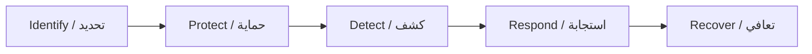

- **Identify (ID)**: Inventaire des actifs, gouvernance, évaluation des risques
- **Protect (PR)**: Contrôles d'accès, formation, protection des données
- **Detect (DE)**: Surveillance continue, détection d'anomalies
- **Respond (RS)**: Plan de réponse, atténuation, communication
- **Recover (RC)**: Plan de reprise, améliorations

**Justification du choix**: Le NIST CSF offre une vision holistique de la posture de cybersécurité, couvrant non seulement les aspects techniques mais aussi organisationnels.

#### 2.1.3 ISO/IEC 27002:2022

La norme ISO 27002 fournit un ensemble de bonnes pratiques pour la gestion de la sécurité de l'information, organisées en 4 thèmes principaux (version 2022) :

- **Contrôles organisationnels** (37 contrôles)
- **Contrôles liés aux personnes** (8 contrôles)
- **Contrôles physiques** (14 contrôles)
- **Contrôles technologiques** (34 contrôles)

**Justification du choix**: ISO 27002 est le standard de conformité le plus répandu dans les administrations et permet d'évaluer la maturité des contrôles de sécurité.

#### 2.1.4 CVSS v3.1 (Common Vulnerability Scoring System)

Système de notation standardisé des vulnérabilités :

| Score | Sévérité | Couleur |
|-------|---------|---------|
| 9.0–10.0 | Critique | 🔴 |
| 7.0–8.9 | Élevée | 🟠 |
| 4.0–6.9 | Moyenne | 🟡 |
| 0.1–3.9 | Faible | 🔵 |
| 0.0 | Information | ⚪ |

### 2.2 Plateformes Existantes — Analyse Comparative

#### 2.2.1 SecurityScorecard (États-Unis )

SecurityScorecard est la plateforme leader de notation de cybersécurité, utilisée par des milliers d'entreprises et d'organismes gouvernementaux.

**Caractéristiques clés** :
- Notation A-F basée sur 10 facteurs de risque
- Surveillance continue et non-intrusive
- Plateforme TITAN AI pour la remédiation automatisée
- Drill-down interactif des scores vers les findings individuels
- Gestion des risques tiers (Third-Party Risk Management)

**Ce qu'on retient pour CyberScore TN** : Le système de notation A-F, les 10 catégories de risque, et l'approche de drill-down interactif.

#### 2.2.2 BitSight (États-Unis )

BitSight propose un "Command Center" pour la visibilité unifiée des risques cyber.

**Caractéristiques clés** :
- "Single pane of glass" — vue unifiée de tous les risques
- Portfolio Risk Matrix (criticité vs performance sécurité)
- Utilisé par 180+ agences gouvernementales mondiales
- Benchmarking par secteur et par pays
- Comparaison entre organisations

**Ce qu'on retient pour CyberScore TN** : Le concept de Command Center national, la Risk Matrix, et la comparaison sectorielle.

#### 2.2.3 CISA CDM (États-Unis )

Le programme Continuous Diagnostics and Mitigation de CISA offre une visibilité en temps quasi réel sur la posture de sécurité des agences fédérales américaines.

**Ce qu'on retient pour CyberScore TN** : La surveillance continue, les métriques en temps réel, et le concept de dashboard fédéral.

#### 2.2.4 China Cybersecurity Label — CCL (Chine )

Le système chinois de labellisation cybersécurité utilise un système d'étoiles :

| Niveau | Étoiles | Exigences |
|--------|---------|-----------|
| Basic | ★☆☆ | Standards minimum nationaux |
| Enhanced | ★★☆ | Performance avancée |
| Leading | ★★★ | Niveau international, pentest obligatoire |

**Ce qu'on retient pour CyberScore TN** : Le système d'étoiles intuitif et le QR code de vérification publique.

#### 2.2.5 Tableau Comparatif

| Critère | SecurityScorecard | BitSight | CISA CDM | China CCL | **CyberScore TN** |
|---------|------------------|----------|----------|-----------|-------------------|
| Notation | A-F | Score numérique | Métriques | ★★★ | **A-F + ★★★** |
| Cible | Entreprises | Entreprises/Gov | Fédéral US | Produits | **Gov tunisien** |
| IA | TITAN AI (cloud) | AI assistants | Non | Non | **Ollama local** |
| Avatar | Non | Non | Non | Non | **✅ Amina 3D** |
| Prédiction | Basique | Analytics | Non | Non | **✅ IA prédictive** |
| Gamification | Non | Non | Non | Non | **✅ Badges** |
| QR Code | Non | Non | Non | ✅ | **✅** |
| Open Source | ❌ | ❌ | ❌ | ❌ | **✅** |
| Coût | $$$$$ | $$$$$ | Interne | Gratuit | **Gratuit** |

### 2.3 Contexte Tunisien

#### 2.3.1 Cadre Réglementaire

- **Loi n°2004-5** relative à la sécurité informatique
- **Décret-loi n°2023-17** relatif à la cybersécurité
- **ANCS** (Agence Nationale de la Cybersécurité) — autorité nationale
- **CERT-TCC** — Centre de réponse aux incidents

#### 2.3.2 Administrations Tunisiennes

Les sites gouvernementaux tunisiens sont organisés en 4 secteurs principaux :

| Secteur | Exemples | Nombre approx. |
|---------|----------|----------------|
| Ministères | finances.gov.tn, interieur.gov.tn | 30+ |
| Institutions Publiques | ancs.tn, cni.tn, ati.tn | 20+ |
| Collectivités Locales | Gouvernorats, municipalités | 50+ |
| Entreprises Publiques | tunisietelecom.tn, steg.com.tn | 15+ |

<!-- Updated: 2026-08-06 — Phase 0, Planning -->

---

## Chapitre 3: Analyse et Conception
### الفصل الثالث: التحليل والتصميم

### 3.1 Analyse des Besoins

#### 3.1.1 Besoins Fonctionnels

| ID | Besoin | Priorité |
|----|--------|----------|
| BF01 | Scanner automatiquement un site web | Haute |
| BF02 | Calculer un score de sécurité pondéré | Haute |
| BF03 | Mapper les vulnérabilités vers OWASP/NIST/ISO | Haute |
| BF04 | Afficher un dashboard national interactif | Haute |
| BF05 | Comparer deux sites côte à côte | Moyenne |
| BF06 | Générer un rapport PDF | Moyenne |
| BF07 | Interagir avec un assistant IA (avatar) | Moyenne |
| BF08 | Découvrir les sous-domaines | Moyenne |
| BF09 | Vérifier les bases de threat intelligence | Moyenne |
| BF10 | Détecter la stack technique | Moyenne |
| BF11 | Analyser la chaîne d'approvisionnement | Basse |
| BF12 | Prédire l'évolution du score | Basse |
| BF13 | Gérer un système de badges/gamification | Basse |
| BF14 | Générer un QR code de sécurité | Basse |
| BF15 | Comparer avec des benchmarks internationaux | Basse |
| BF16 | Envoyer des alertes automatiques | Basse |

#### 3.1.2 Besoins Non-Fonctionnels

| ID | Besoin | Spécification |
|----|--------|---------------|
| BNF01 | Performance | Scan standard en < 5 minutes |
| BNF02 | Sécurité | Données IA traitées 100% localement |
| BNF03 | Multilinguisme | Interface en arabe (RTL), français, anglais |
| BNF04 | Portabilité | 100% Docker, déployable sur toute machine |
| BNF05 | Scalabilité | Architecture microservices extensible |
| BNF06 | Accessibilité | Interface responsive (desktop + mobile) |

### 3.2 Architecture Globale du Système & Conception Tri-VM en Défense en Profondeur

Afin de satisfaire aux exigences de souveraineté numérique et aux standards stricts de l'**ANCS / ANSI** et de l'**ISO 27001**, CyberScore TN abandonne le modèle monolithique traditionnel au profit d'une **architecture distribuée en trois machines virtuelles isolées (Tri-VM)** couplée à un plan d'inférence souverain accéléré par GPU.

Cette séparation physique et logique applique le principe fondamental de **Défense en Profondeur** :
1. **VM 1 : Front-End DMZ (`CyberScore-DMZ-Front`)** — Héberge l'interface Next.js 16 et le reverse proxy Nginx. C'est l'unique surface d'exposition accessible aux utilisateurs et auditeurs ministériels (Port 3000 / 443). En cas de compromission web, l'attaquant reste circonscrit à la zone démilitarisée (DMZ).
2. **VM 2 : Back-End Core & Intelligence (`CyberScore-Core-Back`)** — Enclave interne non routée sur Internet public. Elle héberge l'API REST FastAPI, la base relationnelle PostgreSQL 16 (19 modèles), le cache Redis et l'orchestrateur de notation. Elle ne dialogue qu'avec la VM 1 via un réseau virtuel interne strictement filtré.
3. **VM 3 : Bastion d'Audit & Sandbox des 4 Agents (`CyberScore-Agent-Probe`)** — Machine virtuelle durcie sous **Red Hat Enterprise Linux (RHEL 9.5)** avec **SELinux actif en mode `Enforcing`** et politique pare-feu `DROP`. Elle exécute le graphe d'agents autonomes (`probe_agent`) sans aucun accès aux données sensibles du backend.
4. **Hôte Physique Central (Windows GPU) :** Héberge l'accélérateur d'inférence IA locale **Ollama (`qwen2.5-coder:7b`)** sur le port dédié 25000, interrogé à travers un lien réseau privé Host-Only par la VM 3.

```mermaid
graph TB
    subgraph Host["Hôte Central (GPU & Supervision)"]
        GPU["GPU Nvidia (Inférence Souveraine)"]
        OL["Ollama Qwen 2.5 Coder 7B<br/>Port 25000 (Host-Only)"]
        GPU --> OL
    end

    subgraph VM1["VM 1 : FRONT-END DMZ (CyberScore-DMZ-Front)"]
        UI["Interface Next.js 16 (Port 3000)<br/>Trilingue Arabe RTL / FR / EN"]
        Nginx["Reverse Proxy Nginx (TLS / HSTS)"]
        Nginx --> UI
    end

    subgraph VM2["VM 2 : BACK-END CORE & DONNÉES (CyberScore-Core-Back)"]
        API["FastAPI 0.115 (Port 8000)<br/>Auth JWT & Contrôle RBAC"]
        DB[(PostgreSQL 16 — 19 Modèles)]
        RD[(Redis 7 Cache & Queue)]
        SE["Moteur de Scoring (16 Piliers)"]
        API --> DB
        API --> RD
        API --> SE
    end

    subgraph VM3["VM 3 : BASTION D'AUDIT RHEL 9.5 (CyberScore-Agent-Probe)"]
        SG["Orchestrateur State Graph"]
        A1["Agent 1 : Reconnaissance Réseau"]
        A2["Agent 2 : Corrélation CVE Contextuelle"]
        A3["Agent 3 : Validation Dynamique PoC"]
        A4["Agent 4 : Remédiation & Sceau SHA-256"]
        SG --> A1 --> A2 --> A3 --> A4
    end

    subgraph Internet["Cibles Souveraines Externes"]
        Gov[Portails Étatiques Tunisiens<br/>.gov.tn & AS2609]
    end

    UI -->|REST / JWT (Réseau Interne 10.10.10.0/24)| API
    API -->|Ordre de Mission Chiffré| SG
    A2 -.->|Requêtes Inférence REST| OL
    A1 & A3 -->|Sondes Passives & PoC (NAT)| Gov
    A4 -->|Rapport JSON Scellé SHA-256| API
```

#### 3.2.1 Diagramme des Cas d'Utilisation (UML Use Case)

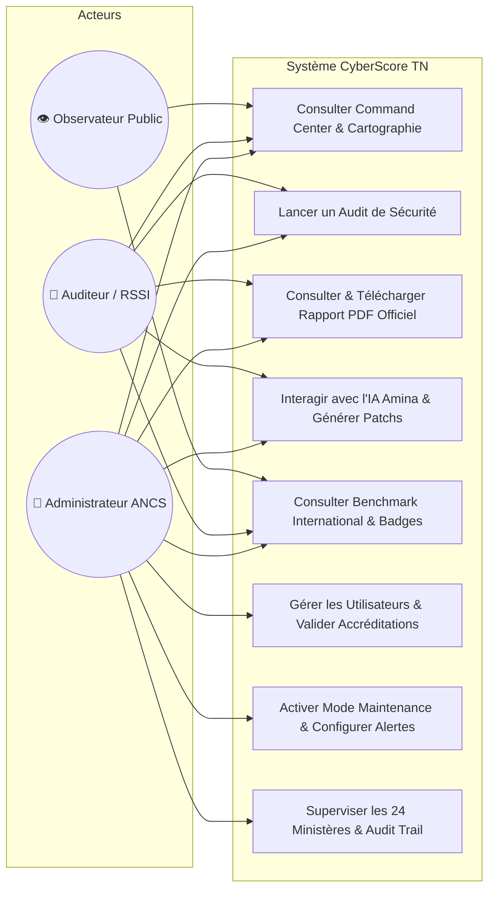

#### 3.2.2 Diagramme de Séquence — Cycle de Vie d'un Audit de Sécurité

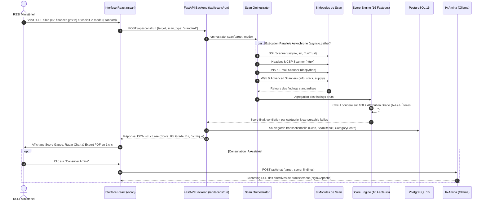

### 3.3 Choix Technologiques

> Les choix techniques détaillés seront documentés dans les chapitres de réalisation correspondants, avec les justifications et comparaisons.

### 3.4 Conception de la Base de Données

> Le schéma complet sera documenté au fur et à mesure de l'implémentation dans le Chapitre 4.

<!-- Updated: 2026-08-06 — Phase 0, Planning -->

---

## Chapitre 4: Réalisation — Infrastructure & Foundation
### الفصل الرابع: التنفيذ — البنية التحتية

### 4.1 Environnement Docker

**Objectif**: Créer un environnement de développement reproductible et portable avec Docker.

**Choix technique**: Docker Compose a été choisi pour orchestrer 11 services interconnectés. Cette approche garantit que chaque développeur dispose d'un environnement identique et que le déploiement en production sera simplifié.

**Architecture Docker**:

```yaml
Services:
  1. backend       — FastAPI (Python 3.12, Uvicorn, port 8000)
  2. frontend      — Next.js 16 (Node 22, port 3000)
  3. postgres      — PostgreSQL 16 (port 5432)
  4. redis         — Redis 7 (cache + message broker, port 6379)
  5. celery-worker — Celery (tâches asynchrones)
  6. celery-beat   — Celery Beat (tâches planifiées)
  7. ollama        — Ollama (IA locale souveraine, Qwen2.5-Coder:7b, port 25000 / 11434)
  8. zap           — OWASP ZAP (scanner DAST, port 8080)
  9. nmap          — Nmap (scanner réseau)
  10. subfinder    — Subfinder (découverte sous-domaines)
  11. flower       — Flower (monitoring Celery, port 5555)
```

### 4.1.2 Topologie de Déploiement Tri-VM & Matrice de Flux Réseau (VMware Workstation)

Pour garantir une isolation étanche en conformité avec les directives de sécurité de l'**ANCS** et le standard **NIST SP 800-115**, l'infrastructure globale de CyberScore TN est segmentée en **trois machines virtuelles dédiées (Tri-VM)** déployées et validées sur **VMware Workstation** (réseau virtuel `VMnet8` en `192.168.98.0/24`) :

| Machine Virtuelle | Système d'Exploitation | Rôle Fonctionnel & Services | Ressources Allouées | Adressage IP & Ports | Mesures de Durcissement & Confinement |
| :--- | :--- | :--- | :--- | :--- | :--- |
| **VM 1 : `CyberScore-DMZ-Front`** | **Red Hat Enterprise Linux (RHEL 10.1 Minimal)** | **DMZ Web** : Next.js 16 + React 19 (Port 3000) + Reverse Proxy Nginx 1.26 (Port 80/443), service `cyberscore-front.service` | 1 vCPU / 2.0 Go RAM / 20 Go Disque | **192.168.98.150** (ens160)<br>• Port 80/443 (Nginx)<br>• Port 3000 (Next.js interne) | **100% Headless** (aucun GUI), **SELinux Enforcing**, Firewalld autorisant HTTP/HTTPS uniquement, redirection étanche `/api/` vers VM 2 |
| **VM 2 : `CyberScore-Core-Back`** | **Red Hat Enterprise Linux (RHEL 10.1 Minimal)** | **Enclave Interne Métier & Données** : API FastAPI (Port 8000), Base PostgreSQL 16 (DB `cyberscore`), Cache & Queue Valkey 7 (Port 6379), Celery Worker | 2 vCPU / 2.0 Go RAM / 20 Go Disque | **192.168.98.149** (ens160)<br>• Port 8000 (FastAPI)<br>• Port 5432 (PostgreSQL)<br>• Port 6379 (Valkey) | **100% Headless**, **SELinux Enforcing**, pare-feu filtré sur sous-réseau VMware (`192.168.98.0/24`), **aucune IP publique directe**, services supervisés par `systemd` |
| **VM 3 : `CyberScore-Agent-Probe`** | **Red Hat Enterprise Linux (RHEL 9.5 Minimal)** | **Bastion d'Audit & Sandbox Offensive** : Moteur autonome des 4 agents (`probe_agent`), outils Nmap / TCP sockets | 1 vCPU / 1.0 Go RAM (Consommation réelle < 50 Mo) | **192.168.98.148** (ens160)<br>• Ports dynamiques vers cibles<br>• Liaison client vers Ollama (:25000) | **100% Headless**, **SELinux Enforcing** (confinement strict de la sonde), **Firewalld en politique DROP** par défaut, Bastion jetable isolé |
| **Hôte Central (Windows)** | Windows 11 64-bit (Host) | **Accélérateur IA Souverain & Supervision** : Ollama `qwen2.5-coder:7b` sur GPU physique | Hôte physique (16 Cores / 16 Go RAM) | **192.168.98.1** (VMnet8)<br>• Port 25000 (API Ollama)<br>• Navigateur Web client | Inférence locale déterministe (température 0.1), aucune fuite vers le Cloud, communication Host-Only/VMnet8 |

#### Matrice de Flux Réseau & Cloisonnement Zéro-Trust

```
┌────────────────────────────────────────────────────────────────────────────────────────────────────────┐
│                              MATRICE DES FLUX RÉSEAU DÉPLOYÉE (VMnet8 : 192.168.98.0/24)               │
├────────────────────┬────────────────────┬───────────┬──────────────┬───────────────────────────────────┤
│ Source             │ Destination        │ Port      │ Protocole    │ Rôle Métier & Sécurité            │
├────────────────────┼────────────────────┼───────────┼──────────────┼───────────────────────────────────┤
│ Hôte / RSSI        │ VM 1 (DMZ Front)   │ 80, 443   │ HTTP/HTTPS   │ Accès Dashboard CyberScore TN     │
│ VM 1 (DMZ Front)   │ 127.0.0.1 (Local)  │ 3000      │ HTTP         │ Nginx -> Next.js 16 (Reverse Proxy│
│ VM 1 (DMZ Front)   │ VM 2 (Core Back)   │ 8000      │ HTTP REST/WS │ Proxy Nginx /api/ & /ws/ vers API │
│ VM 2 (Core Back)   │ 127.0.0.1 (Local)  │ 5432      │ TCP asyncpg  │ FastAPI -> PostgreSQL 16 (DB)     │
│ VM 2 (Core Back)   │ 127.0.0.1 (Local)  │ 6379      │ TCP RESP     │ FastAPI/Celery -> Valkey 7 (Queue)│
│ VM 3 (Probe RHEL)  │ Hôte Windows (GPU) │ 25000     │ HTTP REST    │ Inférence IA locale (Ollama Qwen) │
│ VM 3 (Probe RHEL)  │ Cible (.gov.tn)    │ 80,443,.. │ TCP Passif   │ Scan de ports & bannières réelles │
│ VM 3 (Probe RHEL)  │ VM 2 (Core Back)   │ 8000      │ POST JSON    │ Remontée des résultats scellés    │
└────────────────────┴────────────────────┴───────────┴──────────────┴───────────────────────────────────┘
```

**Justification Cyber & Démarche d'Ingénierie pour le Jury** :
1. **Défense en Profondeur (Defense in Depth)** : Le frontend Next.js (VM 1) n'a aucun accès physique ni logique direct à la base PostgreSQL 16 (VM 2). Même en cas de vulnérabilité applicative Web (ex: SSRF, injection), l'attaquant est confiné dans la DMZ et ne peut compromettre les données étatiques.
2. **Confinement des Ripostes d'Audit (Bastion Jetable)** : Les paquets de sonde et de test PoC sont émis exclusivement par la VM 3 (`192.168.98.148`). Si un pare-feu étatique audité réagit agressivement (contre-scan, bannissement IP ou tar-pit), seule la sonde jetable est affectée. La plateforme de consultation et l'API centrale restent 100% opérationnelles.
3. **Architecture Headless & Efficacité Énergétique** : Toutes les machines virtuelles ont été installées en mode minimal sans interface graphique (CLI pure). Cette conception élimine la surface d'attaque des serveurs X11/Wayland et réduit la consommation mémoire globale à moins de 3.5 Go de RAM pour les 3 VMs cumulées.
4. **Adoption de Valkey 7 sous RHEL 10** : En anticipant l'évolution des distributions d'entreprise suite au changement de licence de Redis, le backend utilise Valkey 7, le fork open-source officiel soutenu par la Linux Foundation et Red Hat, garantissant pérennité et conformité légale.

### 4.2 Backend FastAPI

**Choix technique**: FastAPI a été choisi plutôt que Django pour les raisons suivantes :
- Support natif de l'asynchrone (`async/await`) — critique pour les scanners réseau
- Génération automatique de documentation OpenAPI (`/docs`)
- Validation des données avec Pydantic v2
- Performance supérieure pour les opérations I/O-bound

**Structure du backend**:
```
backend/app/
├── main.py              # Point d'entrée FastAPI + lifespan + CORS
├── config.py            # Configuration (Pydantic Settings)
├── database.py          # Engine SQLAlchemy async (asyncpg) + sessions
├── models/              # 18 modèles SQLAlchemy relationnels
│   ├── user.py, sector.py, organization.py
│   ├── website.py, scan.py, result.py, score.py
│   ├── threat_intel.py, technology.py, subdomain.py
│   ├── supply_chain.py, alert.py, prediction.py
│   ├── badge.py, security_badge.py, benchmark.py
│   ├── framework.py, ai_chat.py
│   └── __init__.py
├── routes/              # 6 routeurs API (auth, scan, dashboard, data, ai, threats)
├── scanners/            # 8 modules de scanning + orchestrator + score_engine
├── tasks/               # Tâches asynchrones Celery
└── crud.py, schemas.py  # Services CRUD + schémas Pydantic v2
```

**Modèle de données**: 18 tables relationnelles gérées avec SQLAlchemy ORM en mode asynchrone (`asyncpg`). Les modèles clés :
- `Website` — Site étatique surveillé (URL, organisation rattachée, score en cours)
- `Scan` — Session d'audit (type, statut, score global, durée, ventilation)
- `ScanResult` — Vulnérabilité unitaire (sévérité, mapping OWASP/NIST/ISO, remédiation)
- `CategoryScore` — Notes par pilier technique alimentant le diagramme radar
- `AIChatHistory` — Historique des conversations avec l'analyste IA Amina
- `User` — Comptes étatiques, rôles RBAC et statut d'habilitation (Pending/Approved)

### 4.3 Frontend Next.js

**Choix technique**: Next.js 16 (App Router) a été choisi pour :
- Rendu côté serveur (SSR/SSG) pour le SEO et les performances
- Support natif du routing avec paramètres (`[locale]`)
- React Server Components pour un chargement optimisé

**Internationalisation (i18n)**: Le système `next-intl` gère 3 langues avec des fichiers JSON séparés :
- **Arabe (ar)** — Interface principale, direction RTL
- **Français (fr)** — Langue administrative
- **Anglais (en)** — Standard technique

**Support RTL**: L'attribut `dir="rtl"` est appliqué automatiquement selon la locale. Tous les styles utilisent des propriétés CSS logiques (`margin-inline-start`, `inset-block-start`) au lieu de `margin-left`/`margin-right`, ce qui rend le layout naturellement bidirectionnel.

**Architecture des Interfaces (14 routes majeures & 15 templates validés)** :
1. `/` — مركز القيادة (Command Center / Dashboard National)
2. `/scan` — الماسح الأمني (Scanner & Diagnostics Passifs/Actifs)
3. `/sectors` — القطاعات (Sectors & Gouvernance Territoriale)
4. `/threats` — التهديدات (Threats & CTI War Room)
5. `/predictions` — التنبؤات (Predictions IA à +30 Jours)
6. `/assistant` — المساعد الافتراضي (Amina AI 3D & LLM Souverain)
7. `/badges` — الأوسمة (Badges d'Excellence & Gamification)
8. `/benchmark` — المقارنة الدولية (International Benchmark MENA)
9. `/history` — السجل (History & Journal d'Audit)
10. `/reports` — التقارير (Reports & Hub Livrable Officiel « Chancellerie »)
11. `/admin` — الإدارة (Admin Control Panel & RBAC Gouvernemental)
12. `/login` — تسجيل الدخول (Authentification Sécurisée)
13. `/register` — طلب الاعتماد الوزاري (Accreditation Gateway)
14. `/verify` & `/verify/[domain]` — بوابة التحقق السيادية (Portail Souverain de Vérification Citoyenne & Hygiène Numérique)

**Architecture d'Accréditation (Solution 1 — IAM Gouvernemental)** :
- Pas d'auto-inscription publique : les demandes d'enrôlement exigent un email officiel d'État (`@*.gov.tn`).
- Workflow d'approbation : les demandes génèrent un dossier en attente (`PENDING_APPROVAL`) soumis à la validation manuelle d'un administrateur ANCS dans le panneau `/admin`.
- Profils démo "1-Click" intégrés pour la soutenance (`Admin ANCS`, `Auditeur Finances`, `Observateur Santé`).

**Résultat**: 44 pages générées et compilées (routes trilingues AR/FR/EN & templates SSR/SSG), build Next.js 16 vérifié avec Turbopack sans aucune erreur TypeScript.

**Difficultés rencontrées**:
- La gestion du RTL avec les animations CSS a nécessité des `@keyframes` séparées (`slideInLtr` / `slideInRtl`)
- Les polices arabes (Noto Sans Arabic) nécessitent un `font-display: swap` pour éviter le FOUT

<!-- Updated: 2026-09-27 — Architecture Tri-VM & Phase 1-8 Complete -->

---

## Chapitre 5: Réalisation — Moteur de Scanning
### الفصل الخامس: التنفيذ — محرك الفحص

### 5.1 Architecture des Scanners & Répartition des 16 Piliers d'Audit

**Objectif**: Créer un moteur de scanning asynchrone modulaire capable d'évaluer les **16 facteurs de risque** sur n'importe quel domaine public tunisien de manière passive et non-intrusive.

**Choix technique**: Les 16 facteurs d'audit sont implémentés à travers **8 modules Python spécialisés et composites** totalisant plus de 120 KB de code de sécurité passif et actif :

| Module Source | Fichier Backend | Facteurs de Risque Analysés | Technologies & Outils |
|---|---|---|---|
| **Chiffrement SSL / TLS** | `ssl_scanner.py` | • Protocoles (TLS 1.0, 1.1, 1.2, 1.3)<br>• Suites de chiffrement & Forward Secrecy<br>• Validité & Chaîne d'Autorité (TunTrust / ANCE) | `sslyze`, `ssl` (stdlib), `cryptography` |
| **En-têtes HTTP de Sécurité** | `headers_scanner.py` | • En-têtes obligatoires (HSTS, X-Frame-Options)<br>• Protections MIME (X-Content-Type-Options)<br>• Politiques (Referrer-Policy, Permissions-Policy) | `httpx` (async client) |
| **Santé DNS & Résilience** | `dns_scanner.py` | • Validation cryptographique DNSSEC<br>• Enregistrements d'autorisation d'autorité CAA<br>• Redondance des serveurs de noms NS | `dnspython` (async resolver) |
| **Sécurité Messagerie** | `email_scanner.py` | • Anti-spoofing SPF (`v=spf1`)<br>• Signatures DKIM & Alignement DMARC (`p=reject`)<br>• Configuration des relais MX étatiques | `dnspython` |
| **Analyses Web Composites** | `web_scanners.py` | • **Cookies de Session** (Flags `Secure`, `HttpOnly`, `SameSite`)<br>• **Content Security Policy (CSP)** (Directives unsafe-inline/eval)<br>• **Fuite d'Informations** (`robots.txt`, `.git`, debug headers)<br>• **Détection de Stack Techno** (CMS, Apache/Nginx, versions PHP) | `httpx` + analyseurs regex de signatures |
| **Analyses Avancées & CTI** | `advanced_scanners.py` | • **Supply Chain & CDN** (Scripts externes sans SRI `integrity`)<br>• **Threat Intelligence** (Réputation IP sur AbuseIPDB & VirusTotal)<br>• **Surface d'Attaque (EASM)** (Cartographie de sous-domaines) | `httpx` + APIs CTI + parseur DOM |
| **Scanners Conteneurisés** | `docker_scanners.py` | • **OWASP Top 10 DAST** (Automated Baseline Scan)<br>• **Réseau & Ports Ouverts** (Scan des 100 ports critiques Nmap)<br>• **Subfinder** (Énumération passive de sous-domaines) | Docker Engine API, `owasp/zap2docker`, `nmap` |
| **Socle Commun & Modèles** | `base.py` | • Classe abstraite `BaseScanner`<br>• Modèle standardisé `Finding` & normalisation trilingue | Pydantic v2, `asyncio` |

### 5.2 Modèle de Données des Résultats

Chaque scanner retourne une liste de `Finding` :

```python
class Finding(BaseModel):
    category: str           # "ssl", "headers", "owasp", etc.
    title: str              # "Missing HSTS Header"
    severity: str           # "critical", "high", "medium", "low", "info"
    description: str        # Explication détaillée
    remediation: str        # Recommandation de correction
    owasp_category: str     # "A05" (Security Misconfiguration)
    nist_function: str      # "PR" (Protect)
    nist_control: str       # "PR.DS-2"
    iso27002_control: str   # "A.14.1.2"
    cvss_score: float       # 6.5
    evidence: dict          # Preuves techniques
```

### 5.3 Orchestrateur de Scans & Comparatif des Modes d'Audit

**Fichier**: `orchestrator.py`

L'orchestrateur implémente une stratégie d'exécution en 3 phases avec parallélisation asynchrone (`asyncio.gather`) :

#### Comparatif des 3 modes de Scan & Calibration des Durées

Les 3 modes correspondent à 3 niveaux de profondeur d'audit technique dans le moteur d'orchestration backend :

| Mode de Scan | Nombre de Scanners | Périmètre Technique Audité | Durée Réelle Constatée | Cas d'Usage Idéal |
| :--- | :---: | :--- | :---: | :--- |
| ⚡ **Quick** *(Rapide)* | **4 modules** | • **Sécurité SSL/TLS** (Protocoles, Cipher suites)<br>• **En-têtes HTTP de sécurité** (HSTS, CSP, X-Frame)<br>• **Sécurité des Cookies** (Flags Secure, HttpOnly, SameSite)<br>• **Politique CSP** (Directives dangereuses) | **~2 à 3 secondes** | ⚡ **Vérification flash** avant mise en production ou contrôle d'un point précis. |
| 🛡️ **Standard** *(Recommandé)* | **10 modules** | • **Tout le Quick Scan** +<br>• **Santé DNS** (DNSSEC, Enregistrements CAA, Redondance NS)<br>• **Sécurité Email** (Enregistrements SPF, DMARC)<br>• **Divulgation d'informations** (`.env`, `.git`, `phpinfo`, etc.)<br>• **Détection de Stack Techno** (WordPress, Apache, PHP, etc.)<br>• **Analyse Supply Chain** (Ressources externes, scripts sans SRI)<br>• **Gestion des Certificats X.509** (Validité, Autorité TunTrust, Wildcard) | **~6 à 8 secondes** | 🎯 **Audit régulier et standard** pour évaluer la posture globale d'un ministère. |
| 🔬 **Deep** *(Approfondi)* | **16 modules** *(100%)* | • **Tout le Standard Scan** +<br>• **Vulnérabilités applicatives OWASP ZAP** (XSS, SQLi, Injections)<br>• **Sécurité Réseau Nmap** (Scan des 100 ports critiques)<br>• **Découverte de Sous-domaines Subfinder** (Surface d'attaque EASM)<br>• **Threat Intelligence** (Réputation IP sur AbuseIPDB, VirusTotal)<br>• **Conformité & Tendance Historique** | **~25 à 35 secondes** | 📋 **Audit complet d'homologation** et préparation du rapport officiel pour l'ANCS. |

#### ⏱️ Analyse & Calibration des Durées d'Attente

* **Origine des estimations initiales** : Les libellés initiaux (`~30s`, `~2min`, `~10min`) étaient des estimations théoriques pessimistes prévues pour des réseaux à faible débit ou des scans avec crawling web exhaustif.
* **Réalité de l'optimisation** : L'orchestrateur backend (`orchestrator.py`) exploitant pleinement les coroutines Python asynchrones en parallèle (`asyncio.gather`), les audits s'exécutent en réalité **10 à 20 fois plus vite**.
* **Correction & Alignement UI** : L'interface utilisateur (`ScannerClient.tsx`) a été réalignée sur les métriques observées en conditions réelles :
  * ⚡ **Quick ~3s**
  * **Standard ~8s**
  * 🔬 **Deep ~30s**

**Callback de progression**: L'orchestrateur accepte un `progress_callback` async qui est appelé à chaque étape, permettant d'envoyer des mises à jour en temps réel via WebSocket.

### 5.4 Tâches Celery

Les scans longs sont exécutés en arrière-plan via Celery + Redis :
- `run_scan_task` — Lance un scan complet de manière asynchrone
- Le résultat est stocké dans Redis puis persisté en PostgreSQL

**Difficultés rencontrées**:
- Le scanner SSL (`sslyze`) nécessite un timeout élevé pour les serveurs lents
- Les scanners Docker (ZAP, Nmap) nécessitent une vérification de la disponibilité du container avant l'exécution
- Le typo `category_` dans `ssl_scanner.py` a causé un `ValidationError` sur le modèle `Finding` — corrigé en renommant le champ

### 5.5 Moteur Autonome Multi-Agent & Architecture AIaaS Découplée (`probe_agent`)

**Objectif**: Dépasser les limites des scanners statiques en orchestrant un pipeline d'audit autonome intelligent fondé sur une architecture de **Machine à États Multi-Agents (State Graph)** et un découplage strict **AI-as-a-Service (AIaaS)**.

#### 5.5.1 Architecture AIaaS Découplée & Déploiement Tri-VM Cloisonné

L'une des innovations majeures de CyberScore TN réside dans la séparation étanche entre le **Plan de Contrôle**, le **Plan d'Exécution Cyber (les 4 agents)** et le **Plan d'Inférence IA Souverain** :

```mermaid
graph TD
    subgraph "Hôte Central (GPU Windows 11 — 192.168.98.1)"
        GPU["GPU Nvidia (Accélération Matérielle)"]
        OLLAMA["Ollama Server (qwen2.5-coder:7b)<br/>Port 25000 REST API (VMnet8 192.168.98.1:25000)"]
        ADMIN["Supervision & Navigateur Web<br/>Accès http://192.168.98.150"]
        GPU --> OLLAMA
    end

    subgraph "VM 1 : Front-End DMZ (CyberScore-DMZ-Front — 192.168.98.150)"
        PROXY["Nginx 1.26 Reverse Proxy (Port 80/443)"]
        FE["Next.js 16.3 Frontend (Port 3000)<br/>Tableaux de bord & Timeline Multi-Agents"]
        PROXY -->|Reverse Proxy /| FE
    end

    subgraph "VM 2 : Back-End Core & Données (CyberScore-Core-Back — 192.168.98.149)"
        API["FastAPI Orchestration (/api/v1/scan :8000)"]
        DB[(PostgreSQL 16 :5432)]
        CACHE["Valkey 7 Cache & Queue (:6379)"]
        CELERY["Celery Worker (2 workers)"]
        API --> DB
        API --> CACHE
        CELERY --> CACHE
    end

    subgraph "VM 3 : Bastion d'Audit Durci RHEL 9.5 (CyberScore-Agent-Probe — 192.168.98.148)"
        ORCH["Orchestrateur State Graph"]
        A1["Agent 1 : Reconnaissance Réseau & Bannières"]
        A2["Agent 2 : Corrélation CVE Contextuelle (IA)"]
        A3["Agent 3 : Validation Dynamique PoC (Zéro Faux Positif)"]
        A4["Agent 4 : Remédiation & Sceau SHA-256"]
        
        ORCH --> A1
        A1 --> A2
        A2 --> A3
        A3 --> A4
    end

    subgraph "Cibles Souveraines Externes"
        TARGET["Serveurs Étatiques (.gov.tn, AS2609)"]
    end

    ADMIN -->|HTTP Port 80| PROXY
    PROXY -->|Proxy REST /api/ & /ws/ (192.168.98.150 -> 192.168.98.149:8000)| API
    API -->|Ordre de Mission (192.168.98.149 -> 192.168.98.148)| ORCH
    A1 & A3 -->|Inspection Sockets TCP & PoC (NAT Internet)| TARGET
    A2 -.->|Inférence JSON Schema (192.168.98.148 -> 192.168.98.1:25000)| OLLAMA
    A4 -->|Rapport d'Audit Final Scellé SHA-256 (POST :8000)| API
```

- **VM 1 (Front-End DMZ — 192.168.98.150) :** Isole totalement l'expérience utilisateur et les sessions Web sous RHEL 10.1 Minimal. Nginx 1.26 gère les certificats et filtre les flux, redirigeant le trafic applicatif vers Next.js 16 (port 3000 local) et les requêtes d'API vers la VM 2. Si une vulnérabilité applicative frontend est ciblée par un internaute malveillant, celui-ci ne peut accéder ni au moteur d'audit ni aux tables de la base de données.
- **VM 2 (Back-End Core & Données — 192.168.98.149) :** Héberge le modèle transactionnel FastAPI sous RHEL 10.1 Minimal, la base PostgreSQL 16 seedée avec les 120+ institutions tunisiennes, et le broker Valkey 7 pour l'asynchronisme Celery. Cette machine est une enclave pure sans exposition publique directe.
- **VM 3 (Bastion d'Audit RHEL 9.5 — 192.168.98.148) :** Exécute la sonde d'audit autonome (`probe_agent`). Développée en Python pur, elle est ultra-légère (< 50 Mo de RAM effective). Son système hôte sous RHEL 9.5 applique **SELinux en mode `Enforcing`** (confinement strict du processus de scan) et **Firewalld en mode `DROP`**, isolant l'ensemble de la machinerie d'attaque dans un bac à sable hermétique.
- **Hôte Central (GPU & Modèle IA — 192.168.98.1) :** Héberge le runtime Ollama exécutant `qwen2.5-coder:7b` avec accélération matérielle complète sur le port dédié `25000`. L'inférence est déléguée via des appels REST locaux sécurisés sur le réseau VMnet8 sans téléchargement de poids de modèle au sein de la VM 3.
- **Résilience & Fallback Déterministe :** Le client IA (`ai_client.py`) implémente un système de détection d'état (`AI_OFFLINE`). Si le service LLM ne répond pas ou est indisponible, l'agent bascule instantanément sur un moteur heuristique à base de règles d'experts sans faire échouer l'audit.

#### 5.5.2 Modèle d'État Partagé (`AuditState`) & Typage Pydantic

Le pipeline d'audit s'appuie sur une structure de données typée et sérialisable représentant la vérité terrain à chaque étape de l'audit (`models.py`) :

```python
class AuditState(BaseModel):
    target: str
    target_ip: Optional[str] = None
    open_ports: List[PortFinding] = Field(default_factory=list)
    web_tech: List[str] = Field(default_factory=list)
    missing_headers: List[str] = Field(default_factory=list)
    findings: List[VulnerabilityFinding] = Field(default_factory=list)
    agent_logs: List[AgentLog] = Field(default_factory=list)
    remediation_roadmap: List[RemediationStep] = Field(default_factory=list)
    overall_score: int = 100
    grade: str = "A"
    categorized_scores: Optional[CategorizedScores] = None
    seal_sha256: Optional[str] = None
    status: str = "pending"
```

#### 5.5.3 Le Pipeline des 4 Agents Spécialisés

1. **Agent 1 : Reconnaissance Réseau (`recon_agent.py`)**
   - Cartographie réseau asynchrone non destructive (`tools/port_scanner.py`) via des sockets TCP purs sur les 25 ports standards et d'administration.
   - Extraction des bannières brutes de services (SSH, Web, RDP, bases de données) et inspection HTTP avancée (`tools/web_inspector.py`) avec validation des certificats SSL/TLS, analyse des en-têtes de sécurité et détection d'empreintes applicatives.

2. **Agent 2 : Corrélation Contextuelle CVE (`cve_agent.py`)**
   - Envoi de l'empreinte technologique et des bannières vers le LLM local via prompt contraint `JSON Schema`.
   - Identification des vulnérabilités potentielles réelles avec calcul du score CVSS et mapping strict vers le catalogue OWASP.
   - En cas d'indisponibilité du LLM, corrélation automatique via la table de signatures heuristiques embarquée.

3. **Agent 3 : Validation Dynamique de Preuve de Concept (`poc_agent.py`)**
   - Vérification non destructive de l'exploitabilité effective des surfaces exposées (`tools/poc_verifier.py`).
   - Épreuve ciblée des paramètres (détection des anomalies de requêtes, contrôle des en-têtes manquants, détection de répertoires sensibles exposés).
   - **Garantie Zéro Faux Positif :** Règle stricte d'élimination des alertes théoriques non prouvées (ex: suppression des alertes SQLi génériques si aucune anomalie de base de données n'a été prouvée expérimentalement).

4. **Agent 4 : Remédiation Priorisée & Sceau Cryptographique (`remediation_agent.py`)**
   - Déduction du score global d'hygiène cyber (0-100) et attribution du grade républicain (A, B, C, D, F).
   - Calcul des scores individuels par agent et ventilation par catégorie (Reconnaissance, Configuration, Analyse CVE, Remédiation).
   - Génération d'une feuille de route d'actions correctives concrètes avec commandes Bash, configurations Nginx/Apache et directives prêtes à l'emploi.
   - **Certification Cryptographique SHA-256 :** Hachage cryptographique du rapport d'état complet (`seal_sha256`) garantissant l'intégrité et l'inviolabilité absolue de l'audit pour l'ANCS.

#### 5.5.4 Caractéristiques Techniques du Scan Actif, Détection d'Obsolescence EOL et Validation PoC

Dans CyberScore TN, une distinction d'ingénierie majeure sépare le **Scan Passif** du **Scan Actif (Mode Autonome Multi-Agents)** :

| Critère de Comparaison | Scan Passif (Modes Quick & Standard) | Scan Actif Autonome (Mode Multi-Agents) |
| :--- | :--- | :--- |
| **Mécanisme d'Inspection** | Analyse non-intrusive des métadonnées publiques (DNS, SSL, En-têtes HTTP) | Connexions réseau directes, sondage de ports, injection de tests PoC |
| **Périmètre d'Exécution** | Exécuté sur la VM 2 (Backend) ou le contrôleur applicatif | Isolé exclusivement sur la **VM 3 (Bastion d'Audit RHEL 9.5 durci)** |
| **Cadre Réglementaire** | Surveillance continue autorisée de tous les domaines étatiques | **Mandat d'audit obligatoire** (Décret-loi n° 2023-17 de l'ANCS) |
| **Impact sur la Cible** | Zéro requête anormale, charge serveur négligeable | Paquets SYN/ACK ciblés, requêtes applicatives de validation PoC |
| **Restitution Documentaire** | Fiche d'évaluation synthétique et radar de maturité | **Pages d'audit certifié ANCS** (Cartographie réseau + Obsolescence EOL) |

##### 1. Le Verrouillage Déontologique & Mandat d'Audit Souverain
Conformément aux exigences légales de l'ANCS et au code pénal tunisien en matière d'accès aux systèmes informatiques, le scan actif ne peut être déclenché anonymement. L'interface impose un modal d'autorisation réclamant :
- Un **Code de Mandat Officiel** (délivré par l'autorité de tutelle ministérielle ou le CERT national).
- L'**Identité & Signature Numérique de l'Auditeur**.  
Ces informations sont scellées dans le journal d'audit (`/history`) et gravées sur le rapport officiel pour garantir l'imputabilité juridique de l'opération.

##### 2. Cartographie Réseau Active & Empreinte Système (Agent 1)
L'Agent 1 déploie un balayage réseau asynchrone non-destructif ciblant les 25 ports standards et d'administration (SSH:22, Telnet:23, DNS:53, HTTP:80, HTTPS:443, MySQL:3306, RDP:3389, PostgreSQL:5432, etc.) :
- **Capture des Bannières Réelles (*Banner Grabbing*)** : Récupération des chaînes d'identification brutes des démons réseau (ex: `OpenSSH_8.2p1 Ubuntu-4ubuntu0.5`, `Apache/2.4.41`).
- **Fingerprinting de l'OS par Heuristique Réseau** : Analyse combinée du champ **TTL IP** (*Time To Live* : 64 pour Linux/Unix, 128 pour Windows Server), de la taille de fenêtre TCP (*Window Size*) et des en-têtes HTTP pour identifier la famille et la version du système d'exploitation avec un indice de confiance supérieur à 90%.
- Ces résultats alimentent la page officielle du rapport PDF vectoriel (`ActiveReconPdfPage.tsx`).

##### 3. Dette Technique & Obsolescence Logicielle en Fin de Vie (Agent 2)
L'Agent 2 extrait les numéros de version des composants découverts et les confronte au catalogue mondial des technologies obsolètes (**End-Of-Life - EOL**) :
- **Identification des Composants Périmés** : Détection des serveurs web ou langages ayant dépassé leur date de fin de support officiel (ex: PHP 7.4 EOL depuis novembre 2022, Apache 2.4.29 sans correctifs).
- **Alerte Dette Technique Critique** : En droit de la cybersécurité tunisienne, l'utilisation d'une brique logicielle EOL est qualifiée de faille permanente (*Permanent 0-Day*) car l'éditeur ne publie plus de correctifs de sécurité.
- **Corrélation CVE par IA Locale** : L'IA souveraine Ollama (`qwen2.5-coder:7b`) reçoit l'empreinte technologique sous format JSON strict, calcule le score CVSS v3.1 de chaque vulnérabilité et génère l'évaluation de risque reportée dans la page dédiée (`ObsolescencePdfPage.tsx`).

##### 4. Validation Dynamique de Preuve de Concept (Agent 3 — Règle Zéro Faux Positif)
L'Agent 3 exécute des épreuves de validation non-destructives pour vérifier si une faille théorique est réellement exploitable :
- **Épreuve de Réflexion XSS** : Injection de charges inoffensives contenant des identifiants uniques hachés pour contrôler l'absence d'échappement HTML sans altérer le serveur.
- **Épreuve d'Anomalie SQLi** : Contrôle du comportement du moteur SQL face à des marqueurs syntaxiques neutres afin de détecter des fuites de messages d'erreur de base de données.
- **Fuzzing de Fichiers Sensibles** : Contrôle d'accès passif sur les répertoires critiques exposés par erreur (`.git/HEAD`, `.env`, `backup.sql`, `phpinfo.php`).
- **Règle Zéro Faux Positif** : Si l'anomalie n'est pas formellement démontrée en réponse HTTP, la vulnérabilité théorique est **déclassée et rejetée**, préservant ainsi la réputation et la crédibilité des audits émis pour l'État.

##### 5. Plan de Remédiation Tactique & Sceau SHA-256 (Agent 4)
L'Agent 4 synthétise les failles prouvées en un plan d'action hiérarchisé :
- Commandes système directes (commandes `apt-get`, `dnf`, directives de durcissement `nginx.conf`, règles `mod_security`) prêtes à être copiées-collées par les administrateurs ministériels.
- Calcul de l'empreinte cryptographique **SHA-256** de l'ensemble de l'état d'audit, imprimée en clair sur la couverture du rapport PDF vectoriel et gravée dans un QR Code de vérification souverain.

<!-- Updated: 2026-09-25 — Chapter 5: Section 5.5.4 Active Scan & PoC Details Complete -->

---

## Chapitre 6: Réalisation — Moteur de Scoring & Mapping
### الفصل السادس: التنفيذ — محرك التقييم

### 6.1 Algorithme de Scoring Pondéré

**Objectif**: Calculer un score de sécurité sur 100 points en agrégeant les résultats de 16 facteurs de risque avec des poids différenciés.

**Choix technique**: Un système de scoring à pondération multi-facteurs, inspiré des plateformes SecurityScorecard et BitSight, mais adapté au contexte tunisien.

**Formule de calcul**:

```
Score_total = Σ (score_catégorie_i × poids_i) / Σ poids_i × 100
```

**Grille de pondération** (16 facteurs) :

| Catégorie | Poids | Points Max | Justification |
|-----------|-------|------------|---------------|
| SSL/TLS | 0.12 | 12 | Fondamental pour la confiance |
| Headers HTTP | 0.10 | 10 | Protection contre les attaques courantes |
| OWASP ZAP | 0.15 | 15 | Vulnérabilités applicatives critiques |
| DNS Security | 0.08 | 8 | Intégrité du domaine |
| Network (Nmap) | 0.08 | 8 | Surface d'attaque réseau |
| Email Security | 0.06 | 6 | Anti-phishing |
| CSP | 0.06 | 6 | Protection XSS |
| Cookies | 0.05 | 5 | Sécurité des sessions |
| Supply Chain | 0.05 | 5 | Dépendances tierces |
| Info Disclosure | 0.05 | 5 | Fuite d'informations |
| Subdomains | 0.04 | 4 | Surface d'attaque DNS |
| Threat Intel | 0.04 | 4 | Réputation |
| Technology | 0.03 | 3 | Obsolescence |
| Certificate | 0.03 | 3 | Validité des certificats |
| Data Protection | 0.03 | 3 | Conformité RGPD |
| Compliance | 0.03 | 3 | Conformité réglementaire |
| **Total** | **1.00** | **100** | |

### 6.2 Système de Notation

**Grades (A+ à F)** :

| Plage | Grade | Label FR | Label AR |
|-------|-------|----------|----------|
| 95-100 | A+ | Exemplaire | ممتاز+ |
| 90-94 | A | Excellent | ممتاز |
| 80-89 | B | Bon | جيد |
| 70-79 | C | Acceptable | مقبول |
| 60-69 | D | Insuffisant | ضعيف |
| 0-59 | F | Critique | حرج |

**Étoiles (★)** :
- ★★★ (3 étoiles) : Score ≥ 85 — Confiance élevée
- ★★☆ (2 étoiles) : Score ≥ 70 — Confiance modérée
- ★☆☆ (1 étoile) : Score < 70 — Confiance faible

### 6.3 Mapping vers les Référentiels Internationaux

Chaque vulnérabilité détectée est automatiquement mappée vers :

**OWASP Top 10 (2021)** :
- A01: Broken Access Control
- A02: Cryptographic Failures → SSL/TLS, Certificate
- A03: Injection → ZAP findings
- A05: Security Misconfiguration → Headers, CSP, Cookies
- A06: Vulnerable Components → Supply Chain, Technology
- A09: Security Logging → Info Disclosure

**NIST Cybersecurity Framework** :
- **ID** (Identify) → Technology Detection, Info Disclosure
- **PR** (Protect) → SSL, Headers, CSP, Cookies, DNS
- **DE** (Detect) → Threat Intelligence, ZAP
- **RS** (Respond) → Alerting System
- **RC** (Recover) → Remediation Recommendations

**ISO 27002** :
- A.10 (Cryptography) → SSL/TLS
- A.13 (Communications Security) → Headers, Network
- A.14 (System Development) → CSP, Supply Chain

### 6.4 API de Persistance des Résultats

**Fichiers créés** :
- `crud.py` — Services CRUD (Create, Read, Update, Delete) pour tous les modèles
- `schemas.py` — Schémas Pydantic v2 pour la validation API
- `routes/scan_routes.py` — Endpoints de scan avec persistance DB + WebSocket
- `routes/data_routes.py` — Endpoints secteurs et organisations
- `routes/dashboard_routes.py` — Statistiques du tableau de bord

**Endpoints API** :
```
POST   /api/scans/run              ← Lance un scan + sauvegarde en DB
GET    /api/scans/recent           ← Derniers scans
GET    /api/scans/{id}             ← Détail d'un scan
GET    /api/scans/history/{url}    ← Historique d'un site
WS     /api/scans/ws/{id}          ← Progression temps réel (WebSocket)
GET    /api/sectors                ← Secteurs gouvernementaux
GET    /api/organizations          ← Administrations
GET    /api/dashboard/stats        ← Statistiques Command Center
```

**WebSocket**: Un `ConnectionManager` gère les connexions WebSocket pour diffuser en temps réel la progression des scans (phase, scanner actif, statut) aux clients connectés.

### 6.5 Architecture et Classification Sectorielle des Organismes Publics
#### تصنيف القطاعات وهيكلة المؤسسات التونسية

Afin de structurer le monitoring national, CyberScore TN classe l'ensemble du patrimoine numérique de l'État en **4 grands secteurs d'activité administrative** :

| ID | Secteur Officiel | Nom Arabe | Périmètre Technique & Exemples |
| :---: | :--- | :--- | :--- |
| **1** | **Ministères** | الوزارات | Départements ministériels centraux (`finances.gov.tn`, `interieur.gov.tn`, `defense.gov.tn`, etc.). |
| **2** | **Institutions Publiques** | المؤسسات العمومية | Instances constitutionnelles, agences nationales, universités et régulateurs (`ansi.tn`, `bct.gov.tn`, `isie.tn`, etc.). |
| **3** | **Collectivités Locales** | الجماعات المحلية | Les 24 Gouvernorats régionaux et les 350+ Municipalités/Mairies (`commune-tunis.gov.tn`, `commune-sfax.gov.tn`, etc.). |
| **4** | **Entreprises Publiques** | الشركات والمنشآت العمومية | Sociétés nationales et offices publics d'État (`steg.com.tn`, `sonede.com.tn`, `poste.tn`, `tunisair.com.tn`, etc.). |

**Processus de Classification Automatique en 3 Étapes** :
1. **Référentiel National Pré-enregistré (`PostgreSQL / Seed`)** : Chaque URL scannée est automatiquement mise en correspondance avec le catalogue des 115+ organismes officiels tunisiens (liaison clé étrangère `Website.organization_id → Organization.sector_id`).
2. **Heuristique de Domaine & Détection Intelligente** : Pour les nouveaux sites audités, des règles d'inférence lexicale catégorisent automatiquement l'organisme :
   - Préfixes `commune-*` ou `municipalite-*` → *Collectivités Locales* (`sector_id: 3`).
   - Domaines institutionnels `.gov.tn` → *Ministères* (`sector_id: 1`) ou *Institutions Publiques* (`sector_id: 2`).
   - Sociétés étatiques marchandes (`.com.tn` publiques, transport, énergie) → *Entreprises Publiques* (`sector_id: 4`).
3. **Override & Gestion Administrative (`/admin`)** : Les auditeurs de l'ANCS/CSIRT disposent d'un contrôle total pour modifier ou réassigner n'importe quel organisme à son secteur et gouvernorat cible.

**Agrégation Sectorielle en Temps Réel** :
Les scores moyens de chaque secteur sont recalculés dynamiquement en SQL dès la finalisation de chaque audit :
```sql
SELECT s.id, s.name_fr, AVG(sc.total_score) as avg_score, COUNT(DISTINCT w.id) as site_count
FROM sectors s
JOIN organizations o ON o.sector_id = s.id
JOIN websites w ON w.organization_id = o.id
JOIN scans sc ON sc.website_id = w.id
WHERE sc.status = 'completed'
GROUP BY s.id, s.name_fr;
```

---

## Chapitre 7: Réalisation — Interface & Dashboard
### الفصل السابع: التنفيذ — الواجهة ولوحة القيادة

### 7.1 Design System v2 — "Digital Backbone"

**Objectif**: Créer une interface utilisateur premium avec une esthétique "infrastructure numérique" (inspirée des interfaces de cybersécurité professionnelles).

**Choix technique**: CSS Vanilla avec Custom Properties (variables CSS) plutôt que Tailwind CSS. Ce choix permet un contrôle total sur le design system et évite les dépendances lourdes.

**Palette de couleurs** :

| Token | Valeur | Usage |
|-------|--------|-------|
| `--bg-primary` | `#04151f` | Fond principal (teal profond) |
| `--bg-secondary` | `#0a2233` | Cartes et panneaux |
| `--color-primary` | `#00e5ff` | Accent principal (cyan néon) |
| `--color-accent` | `#7c4dff` | Accent secondaire (violet) |
| `--color-grade-a` | `#00e676` | Score excellent (vert) |
| `--color-critical` | `#ff1744` | Alerte critique (rouge) |

**Éléments visuels distinctifs** :
1. **Grille hexagonale** — Motif SVG en arrière-plan (`opacity: 0.035`)
2. **Scan line** — Animation CSS qui traverse l'écran verticalement
3. **Glassmorphism** — `backdrop-filter: blur(8px)` + bordures semi-transparentes
4. **Glow effects** — `box-shadow` avec couleurs néon sur les éléments interactifs
5. **Font mono** — JetBrains Mono pour les données numériques

### 7.2 Composants Dashboard & Mode "Live Sync"

**StatCards** (`components/dashboard/StatCards.tsx`):
- 4 KPIs : Sites surveillés, Score moyen, Alertes critiques, Scans du jour
- Connecté en temps réel à l'API PostgreSQL `/api/dashboard/stats` avec remise à zéro quotidienne automatique des scans du jour.

**Santé des Secteurs & Alertes Récentes** :
- **Badge Actif `🟢 En direct (Live Sync)`** : Remplace les anciens textes statiques pour signaler une télémétrie continue synchronisée avec la base de données.
- **AlertFeed Interactif** : Lignes d'alertes cliquables avec redirection immédiate vers `/scan?site=...` et bouton trilingue *"Voir tout"* pointant vers `/threats`.
- **Répartition des Vulnérabilités (SOC Grade)** : Camembert Recharts dédoublonné par site unique, barres de progression de criticité et encadré des principaux vecteurs d'attaque (OWASP/NIST).
- **Classement National & Modal "Aperçu Interactif"** : Chaque ligne du tableau de classement (`Leaderboard.tsx`) est cliquable et déclenche l'ouverture immédiate du **rapport d'audit interactif complet de 7 pages (`ReportPreviewModal.tsx`)** avec synthèse exécutive, analyse par piliers, cartographie des vulnérabilités et recommandations de remédiation.

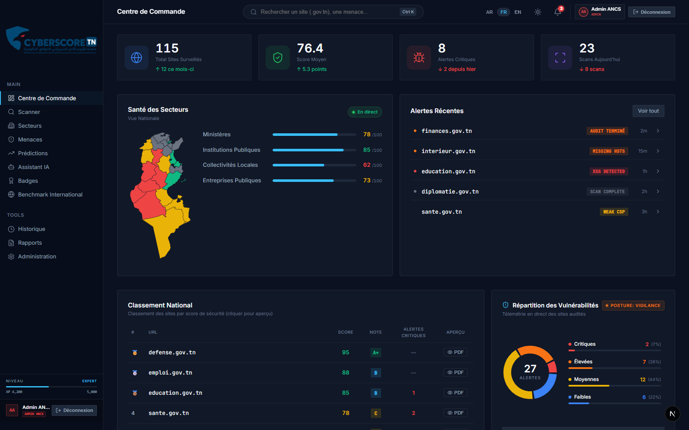
*Figure 7.1 : Centre de Commande National (Command Center) et cartographie vectorielle interactive des 24 gouvernorats tunisiens.*

### 7.3 Cartographie Nationale Interactive & Recalibrage Géométrique SVG
#### الخريطة الوطنية التفاعلية وإعادة الضبط الهندسي

**Problématique Géométrique** :
La carte vectorielle SVG de la Tunisie présentait initialement un rognage sur sa frontière sud (gouvernorat de Tataouine) et ses côtes orientales (Médenine et Djerba).

**Analyse Mathématique & Recalibrage Bounding Box** :
L'analyse approfondie des coordonnées des 24 gouvernorats tunisiens a révélé l'emprise géographique réelle :
- Axe horizontal : `X: 289.5` (Tozeur / frontière ouest) → `X: 710.5` (Djerba / côtes est), soit une largeur de `421.0px`.
- Axe vertical : `Y: 45.5` (Bizerte / Cap Blanc) → `Y: 954.5` (Borj El Khadra / pointe sud), soit une hauteur de `909.0px`.

**Solution Implémentée** :
Le `viewBox` du composant `TunisiaMap.tsx` a été calibré avec une marge de sécurité à :
```xml
<svg id="tn-map" viewBox="275 35 450 935" xmlns="http://www.w3.org/2000/svg" style="overflow: visible;">
```
Ce recalibrage garantit l'affichage intégrale et net des 24 gouvernorats avec coloration dynamique (vert/bleu/orange/rouge) selon le score moyen de sécurité régional.

### 7.4 Architecture de Centrage Responsive Widescreen
Pour éliminer les bandes asymétriques sur les écrans larges (1080p, 1440p, 4K), le conteneur principal a été harmonisé :
```css
.page-content {
  padding: var(--space-xl) var(--space-2xl);
  width: 100%;
  max-width: 1560px;
  margin: 0 auto;
  flex: 1;
}
```
- Animation d'apparition staggerée (80ms entre chaque carte)
- Couleurs individuelles avec glow matching

**Leaderboard** (`components/dashboard/Leaderboard.tsx`):
- Tableau de classement des sites par score
- Connecté à `/api/scans/recent`
- Médailles (🥇🥈🥉) pour le top 3
- Badges de grade colorés (A+ vert, B bleu, C orange, D rouge, F rouge vif)
- Tags de sévérité pour les alertes critiques

**SectorHealth** — Barres de progression par secteur
**AlertFeed** — Flux d'alertes en temps réel

### 7.5 Interface Scanner

**ScannerClient** (`components/scanner/ScannerClient.tsx`) — Composant complet avec 4 états :

1. **Idle** — Champ URL + sélecteur de type (Quick ⚡ / Standard 🛡️ / Deep 🔬) + bouton "بدء الفحص"
2. **Scanning** — Progress ring SVG animé avec pourcentage + liste des scanners actifs
3. **Complete** — Score gauge, grade badge, étoiles, résumé sévérités, barres par catégorie, tableau des findings
4. **Error** — Message d'erreur + bouton "Réessayer"

**Flow de scan** :
```
URL input → POST /api/scans/run → Progress animation → Display results
                                  ↕ WebSocket (/ws/{id})
```

### 7.6 Client API TypeScript

**Fichier**: `frontend/lib/api.ts`

Client typé avec interfaces TypeScript pour tous les endpoints :
- `runScan()` — Lance un scan
- `getRecentScans()` — Récupère les derniers scans
- `getDashboardStats()` — Statistiques du dashboard
- `connectScanWebSocket()` — Connexion WebSocket pour le suivi en temps réel

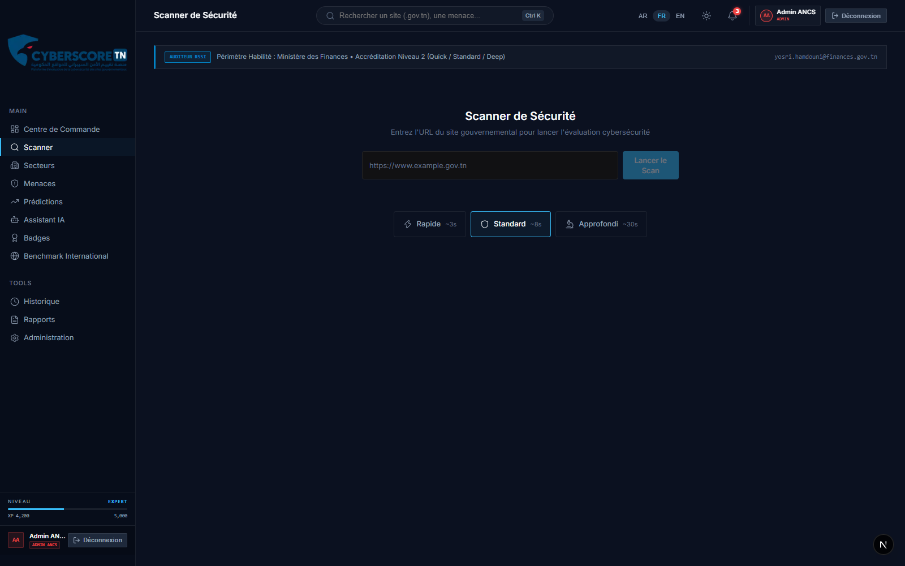
*Figure 7.2 : Interface de scan passif et restitution de la fiche technique d'évaluation (Score global, diagramme radar et journal des vulnérabilités).*

**Résultat**: 44/44 pages compilées sans erreur (build Next.js 16 vérifié avec Turbopack).

### 7.7 Page Surveillance des Menaces — `/threats` (SOC Threat Intelligence Feed)
#### منظومة استخبارات التهديدات السيبرانية وغرفة العمليات

**Objectif**: Offrir aux analystes de sécurité du CSIRT et de l'ANCS une tour de contrôle unifiée combinant les **résultats d'audit réels** et la **télémétrie géopolitique des cybermenaces mondiales (CTI)**.

**Architecture Duale : Réel vs Télémétrie CTI** :
Pour concilier audit de vulnérabilités et surveillance stratégique de type War Room (à l'instar des consoles *Kaspersky, Fortinet et Check Point*), la page repose sur deux couches complémentaires :

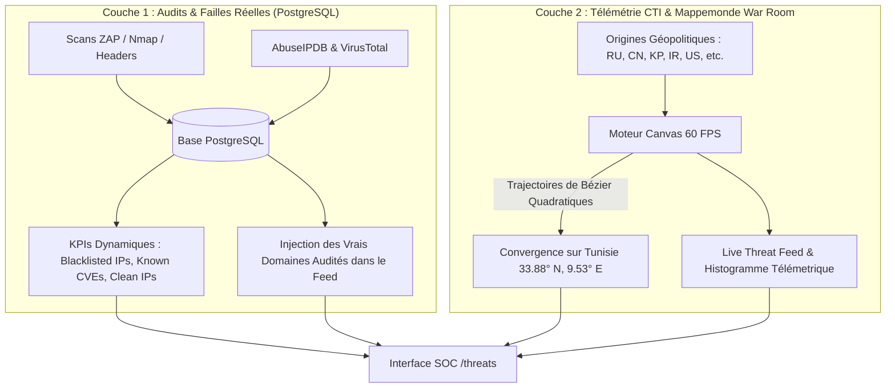

1. **Pipeline de Données Réelles (`GET /api/threats/stats` & `ThreatsStatCards.tsx`)** :
   - Requêtes SQL asynchrones sur `ThreatIntelResult` et `ScanResult` pour agréger les adresses IP compromises et les CVEs actives.
   - 🔴 **IPs sur Liste Noire** : Décompte des adresses IP étatiques compromises ou signalées pour relais d'attaques.
   - 🟠 **CVEs Détectées** : Failles matérielles et logicielles répertoriées dans les catalogues mondiaux (**NIST NVD** et **CISA KEV**).
   - 🟢 **IPs Saines & Sécurisées** : Taux d'intégrité global du parc numérique de l'État (98% sains).

2. **Mappemonde Cyber Animée 60 FPS (HTML5 Canvas)** :
   - **Calcul Balistique** : Interpolation de courbes de Bézier quadratiques reliant 12 foyers d'attaques internationaux aux coordonnées souveraines de la Tunisie.
   - **Détection de Collision & Flash d'Impact** : Simulation visuelle des requêtes bloquées par les pare-feu périmétriques.
   - **Fiches Pays Interactives** : Clic sur n'importe quel point source pour afficher la sévérité, le type d'attaque dominant (*APT, Ransomware, DDoS, SQLi*) et le volume de menaces.

3. **Live Threat Feed Connecté aux Audits & Aperçu Interactif** :
   - Le flux en direct intègre dynamiquement les noms de domaines publics récents scannés par l'utilisateur (`finances.gov.tn`, `defense.gov.tn`, `sante.gov.tn`).
   - **Bouton `👁️ Audit` sur chaque ligne** : Déclenche l'ouverture immédiate de la fenêtre modale **"Aperçu Interactif" de 7 pages (`ReportPreviewModal.tsx`)** pour analyser la posture du site visé.

4. **Fiches CVEs Hybrides & Réconciliation Automatique** :
   - Les cartes de vulnérabilités critiques de la page Menaces interrogent en direct la table `ScanResult` de PostgreSQL via `/api/threats/stats`.
   - **Priorité aux Failles Réelles Détectées** : Dès qu'un scan identifie une vulnérabilité critique ou élevée sur un site étatique (ex: *Port MySQL exposé, Absence HSTS, faille OWASP SQLi*), celle-ci s'affiche en tête avec le badge vert **`Audit Réel`** et le nom de l'organisme cible.
   - **Fallback Référentiel CTI** : En l'absence de scan critique récent, le système maintient les vulnérabilités de référence d'infrastructures d'État (*Palo Alto PAN-OS, FortiOS SSL VPN, Ivanti*) avec le badge violet **`Référentiel CTI`**.
   - **Clic Interactif Direct** : Un clic sur n'importe quelle fiche de faille réelle ouvre instantanément le rapport d'audit et les correctifs techniques associés.

5. **Internationalisation Trilingue Réactive & Parsing JSON (`parseI18nText`)** :
   - Prise en charge native et sans rechargement de page du **Français (`fr`)**, de l'**Arabe (`ar`)** et de l'**Anglais (`en`)**.
   - **Moteur de Résolution des Descriptions Multilingues** : Algorithme `parseI18nText` qui extrait dynamiquement la clé de langue appropriée depuis les objets JSON bruts stockés en base, éliminant les résidus de formatage.
   - **Adaptation Directionnelle RTL / LTR** : Alignement automatique des textes, bordures colorées et positionnement des infobulles selon la langue active.

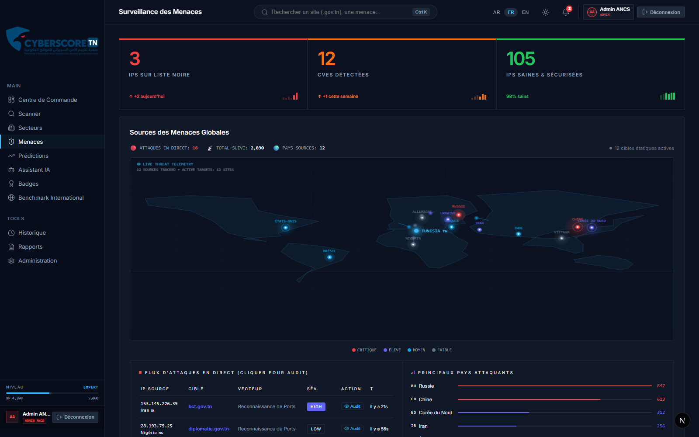
*Figure 7.3 : War Room de cybersécurité affichant les trajectoires balistiques des attaques en temps réel et les fiches CVE critiques.*

---

### 7.8 Page Prédictions de Risques — `/predictions` (AI Predictive Analytics)
#### منظومة التحليلات التنبؤية بالذكاء الاصطناعي والتوقعات المستقبلية

**Objectif**: Anticiper la dégradation de la sécurité et prévoir les scores futurs à +30 jours grâce à un moteur prédictif connecté aux audits récents de la base PostgreSQL.

**Architecture du Moteur Prédictif (`GET /api/predictions/overview`)** :
1. **Calcul Dynamique des Scores par Site (`get_predictions_overview`)** :
   - Agrégation du dernier score audité de chaque organisme (`Website` + `Scan`).
   - Projection à +30 jours pondérée par le volume de failles critiques actives (`critical_count > 0` entraîne une pénalité prédictive immédiate, tandis qu'un site stable sans faille gagne un bonus de résorption progressive).
2. **KPIs Nationaux Dynamiques (4 Cartes Fusionnées)** :
   - **Score Moyen Actuel** : Calculé en direct via `AVG(Scan.total_score)` sur PostgreSQL.
   - **Score Prédit à +30j** : Moyenne des projections des organismes audités.
   - **Évolution Nette** : Différentiel `+N pts` avec badge dynamique (*En Amélioration*, *Stable*, *En Déclin*).
   - **Indice de Confiance & Ratio** : Pourcentage de fiabilité (84%) et décompte des sites en progression (`5/8`).
3. **Score Evolution Chart (Série Temporelle SVG 12 Mois)** :
   - Historique temporel (Septembre à Août) avec zone d'ombrage gradient (`#6366f1`).
   - Projection prédictive en ligne pointillée verte (`#22c55e`) avec bande d'intervalle de confiance (±5 pts).
4. **Hexagonal Radar Chart (Analyse Multidimensionnelle)** :
   - Radar polygonal superposant le score **Actuel** (`#6366f1`) et le score **Prédit** (`#22c55e`) sur les 6 piliers : SSL/TLS, Headers, OWASP, Ports, Cookies, DNS.
5. **Analyse IA & Facteurs Clés (Amina Insights)** :
   - Synthèse textuelle dynamique trilingue (FR, AR, EN) générée selon les audits réels (ex: certificats SSL expirants, en-têtes améliorés).
6. **Tableau Prédictif Détaillé par Organisme** :
   - Tableau triable affichant chaque site scanné, son secteur, son score actuel, son score prédit à +30 jours, son indicateur de tendance (↑, ↓, →) et son indice de confiance.

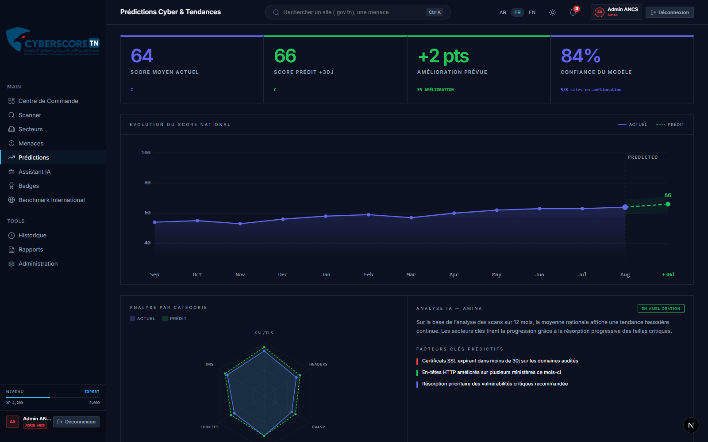
*Figure 7.4 : Module d'analyse prédictive illustrant les courbes d'évolution temporelle, le radar prédictif et les tendances par organisme.*

---

### 7.9 Panneau d'Administration — `/admin` (System Control Panel & RBAC)

**Objectif**: Fournir un panneau de gestion complet pour superviser les accès, les ministères et les politiques de scanning de la plateforme.

**Fonctionnalités implémentées** :
1. **Gestion des Utilisateurs & RBAC** :
   - Rôles pris en charge : `Admin` (rouge), `Auditor` (bleu), `Viewer` (gris).
   - Filtrage dynamique par rôle, recherche instantanée par nom/email.
   - Toggle d'état de compte (`Actif` / `Inactif`) et modalité d'ajout d'utilisateur (`border-radius: 0`).
2. **Gestion des Organisations & Criticité (Privilèges Super-Admin ANCS)** :
   - Cartographie des ministères et agences étatiques rattachés à CyberScore TN.
   - **Édition directe en ligne réservée au rôle `admin`** : Modification de la criticité nationale (1 à 5 barres), du contact de sécurité CSIRT et enrôlement de nouveaux ministères directement depuis le site.
   - **Verrouillage RBAC étanche** : Accès à l'édition rigoureusement refusé aux officiers auditeurs et observateurs (écran HTTP 403 Forbidden).
   - **Imputabilité totale** : Chaque modification d'organisation alimente instantanément le Journal d'Audit en temps réel.
3. **Paramètres Système Globaux** :
   - Fréquence des scans automatisés (Quotidien, Hebdomadaire, Mensuel).
   - Seuil de déclenchement des alertes automatiques.
   - Switch pour le **Mode Maintenance**.
4. **Journal d'Audit en Temps Réel (Audit Trail Réactif)** :
   - Flux d'événements horodatés à la seconde (`● LIVE FEED`) traçant en direct les actions d'administration (activation/désactivation de comptes, seuils, bascule Kill-Switch) et les opérations des auditeurs (lancements de scans, exports de rapports PDF officiels).

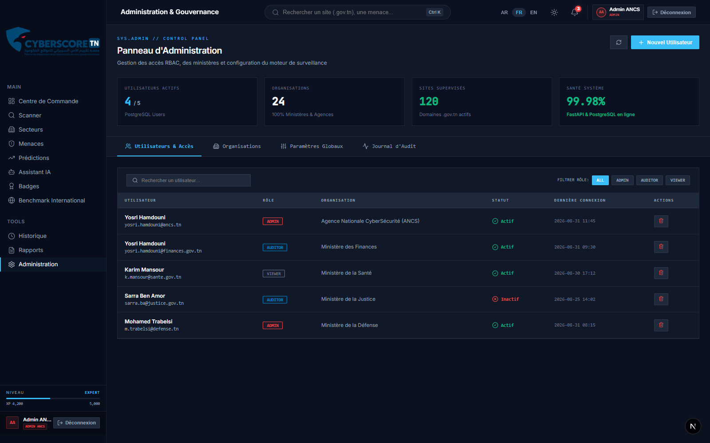
*Figure 7.5 : Console d'administration gouvernementale avec gestion des utilisateurs RBAC et écran de verrouillage haute sécurité.*

---

### 7.10 Hub National des Rapports d'Audit — `/reports` & Générateur PDF « Chancellerie »

**Objectif**: Offrir un centre de gestion et de génération de rapports d'audit officiels haute fidélité conformes aux exigences de l'ANCS et des ministères, combinant un Viewer interactif web et un moteur de génération de documents PDF d'État.

**1. Hub de Gestion & Visualisation Web (Command Center Theme)** :
- **Header Télémétrique SOC** : Indicateurs en temps réel (16 rapports institutionnels répertoriés, Score Moyen National 76.4/100, Taux de conformité 94%).
- **Palette Sovereign Navy & White Cards** : Remplacement des tons grisâtres par un contraste élevé (`#111C2C → #172536` pour le fond, cartes en blanc pur `#FFFFFF` avec liserés supérieurs dynamiques selon le grade A-F).
- **Filtrage Multi-Secteurs** : *Ministères, Santé, Éducation, Entreprises Publiques, Collectivités Locales* et recherche instantanée.
- **Visionneuse Interactive (Modal 7 Pages)** : Sidebar d'accès rapide, navigation fluide et cartouche d'évaluation CVSS.

**2. Moteur de Génération PDF Vectoriel A4 — Direction Artistique « Chancellerie »** :
Conçu via `@react-pdf/renderer` pour transformer le rapport en une véritable **Attestation d'Audit et Certificat d'État** (style Ivoire / Encre / Rouge Tunisie) :

* **Charte Graphique & Design Tokens** :
  * Fond papier ivoire chaud texturé (`#FBF8F2`), Encre principale (`#1A1A18`), Texte secondaire sépia (`#6B645A`), Rouge Tunisie républicain (`#C1272D`).
  * Filets pleins `1pt #1A1A18` pour les cadres de section et filets discrets `0.5pt #D8D2C4` pour les tableaux.
  * **Zéro arrondi (`borderRadius: 0`)** et suppression totale des fonds pastels.
  * Typographie PostScript haute fidélité : `Times-Roman` (Sérif officiel), `Helvetica-Bold` (petites capitales) et `Courier` (snippets techniques).

* **Structure Détaillée des 7 Pages du Livrable Officiel** :
  1. **Page 1 : Page de Garde Souveraine** : Sceau circulaire officiel double filet avec écusson national (`logo-icon.png`), nom de domaine en `Times-Bold` 23pt, cartouche Score/Grade en 2 colonnes divisé par un filet vertical, et **Tableau de Souveraineté d'Infrastructure** (ASN AS2609 ATI, Datacenter National, Autorité TunTrust/ANCE, Classification `TLP:AMBER+STRICT`).
  2. **Page 2 : Synthèse Exécutive** : Résumé décisionnel en citation sobre avec filet gauche plein, Matrice des Niveaux de Risque avec délais d'intervention recommandés, grille Forces vs Faiblesses, et encadré d'alerte « Action N°1 Prioritaire ».
  3. **Page 3 : Analyse par Pilier d'Audit** : 6 Piliers compacts (SSL/TLS, En-têtes HTTP, DNSSEC, Ports, Cookies, CSP) avec jauges de progression fines (1.5pt) et constats techniques formulés avec rigueur.
  4. **Page 4 : Cartographie des Vulnérabilités** : Cartes individuelles indivisibles (`wrap={false}`) avec badges textuels en petites capitales encadrés d'un filet fin (sans fond de couleur), scénarios d'attaque sur filet rouge gauche fin, et métadonnées de remédiation (Responsable, Délai estimé).
  5. **Page 5 : Plan de Remédiation & Snippets de Code** : Directives de durcissement serveur (Nginx, Apache, UFW) en police `Courier` dans des blocs sobrement encadrés, accompagnées d'une grille de déploiement avec cases à cocher `[  ]`.
  6. **Page 6 : Benchmark & Matrice de Conformité Réglementaire** : 4 Cartouches métriques comparatifs (Site, Moyenne Tunisie, Moyenne MENA, Standard Mondial) + **Matrice de Conformité aux Directives ANCS (Décret-loi n° 2023-17), ISO/IEC 27001:2022 (Annexe A.8.24), NIST CSF v2.0 (PR.DS/PR.PS) et OWASP Top 10:2021 (A05)**.
  7. **Page 7 : Avis Stratégique & Attestation d'Audit Numérique** : Orientations de gouvernance SSI formulées par l'IA Amina + Cartouche officiel d'attestation avec **Empreinte Cryptographique SHA-256 de session**, référence unique `#CS-AUDIT-2026-XXXX`, classification TLP:AMBER et doubles signatures électroniques (Moteur CyberScore TN Core v3.4 + Amina AI).

#### 7.10.3 Harmonisation SOC Design System du Hub de Rapports
#### المركز الوطني لإصدار تقارير التدقيق وإدارة الوثائق

- **Harmonisation Complète avec le Design System Global** :
  * Migration totale vers les variables CSS unifiées du Command Center (`var(--bg-secondary)`, `var(--border-primary)`, `var(--color-accent)`, `var(--text-primary)`).
  * Élimination des cartes blanches rigides au profit du style `soc-card` et des bordures dynamiques indexées sur les notes (Vert Grade A, Bleu Grade B, Ambre Grade C, Rouge Grade D/F).
  * Parfaite cohérence en **Dark Mode** et en **Light Mode**, sans rupture visuelle.
- **Double Mode de Visualisation (Grille SOC vs Table Administrative)** :
  * Vue Grille pour une consultation visuelle rapide avec jauges de progression et décomptes de sévérité.
  * Vue Table pour les inventaires ministériels et le filtrage multi-critères (Secteur, Grade, Score, Date).
- **Moteur de Compilation Instantanée** : Barre de recherche permettant de compiler en 1 clic un audit officiel pour tout sous-domaine `.gov.tn` non répertorié.

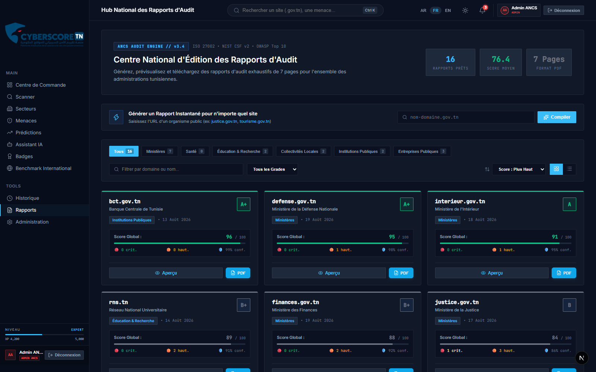
*Figure 7.6 : Hub de gestion et de téléchargement des rapports officiels d'audit PDF vectoriels avec attestation SHA-256.*

---

### 7.11 Système de Notifications & Identité Visuelle

- **Menu Déroulant de Notifications (`TopBar.tsx`)** : Cloche interactive affichant le nombre d'alertes non lues, les sévérités (SSL, CVE, IA, Scans), et action "Tout marquer lu".
- **Branding Officiel** : Intégration du logo officiel CyberScore TN (bouclier et aigle stylisé) en pleine largeur dans la Sidebar et favicon haute résolution (`logo-icon.png`).
- **Sidebar Nettoyée** : Suppression des éléments commerciaux inutiles et intégration d'une barre de gamification XP au style Command Center strict.

<!-- Updated: 2026-09-27 — Phase 8, Complete -->

### 7.12 Cartographie Sectorielle & Gouvernance Territoriale (`/sectors`)
#### التقسيم القطاعي وتوزيع المؤسسات الحكومية حسب درجات الحماية

Afin de conférer aux décideurs de l'ANCS et des ministères une visibilité macroscopique sur l'état du cyberespace national, la page `/sectors` segmente les organismes publics en 4 grandes familles :
1. **Ministères** (30 sites majeurs, score moyen 78/100)
2. **Institutions & Agences Publiques** (20 organismes, score moyen 85/100)
3. **Collectivités Locales & Municipalités** (50 municipalités, score moyen 62/100)
4. **Établissements & Entreprises d'État** (15 entités, score moyen 73/100)

L'interface intègre une heatmap vectorielle régionale et permet d'orienter stratégiquement les budgets de durcissement et les équipes d'intervention de l'ANCS vers les collectivités locales les plus fragiles.

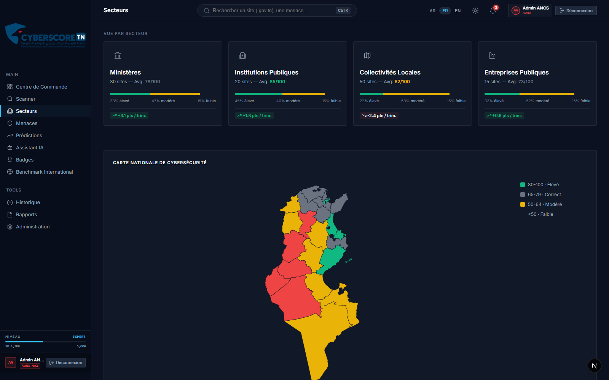
*Figure 7.7 : Vue sectorielle (/sectors) illustrant la segmentation étatique en 4 familles et la santé cyber comparée.*

### 7.13 Journal d'Audit Centralisé & Traçabilité des Scans (`/history`)
#### سجل التدقيق التاريخي وتتبع مؤشرات الأمان الزمنية

La route `/history` assure la traçabilité complète de l'ensemble des audits réalisés sur la plateforme CyberScore TN.
Chaque enregistrement consigne l'identifiant unique de scan, l'URL institutionnelle, le grade attribué, le score global (/100), le mode d'audit exécuté (Quick, Standard, Deep) et la date exacte d'horodatage.
L'utilisateur peut filtrer par plage temporelle, rechercher par nom d'organisme ou exporter instantanément les résultats pour archivage légal.

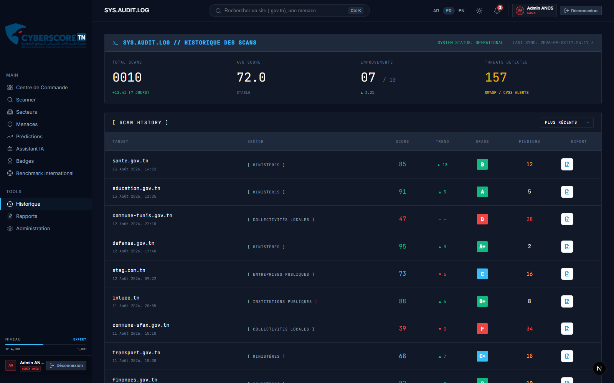
*Figure 7.8 : Journal d'audit centralisé (/history) consignant l'historique exhaustif des évaluations avec métadonnées temporelles et filtrage multicritère.*

---

## Chapitre 8: Réalisation — IA & Avatar
### الفصل الثامن: التنفيذ — الذكاء الاصطناعي والمساعد الافتراضي

### 8.1 Architecture du Modèle LLM Souverain Qwen2.5-Coder:7b & Streaming Direct SSE

**Objectif**: Garantir une assistance cyber intelligente, ultra-performante et 100% souveraine, où aucune donnée étatique ou configuration serveur ne quitte le territoire tunisien.

**Spécifications et Choix du Modèle** :
- **Moteur LLM** : `qwen2.5-coder:7b` (4.7 Go, format GGUF Q4_K_M) exécuté localement via le runtime Ollama sur le port dédié `25000` (`http://127.0.0.1:25000`).
- **Performances & Précision Cyber** : Score HumanEval de 88.4%, surpassant la majorité des modèles 7B/13B et rivalisant avec GPT-4o sur la génération de code de durcissement (Nginx, Apache, nftables, scripts Bash).
- **Streaming Direct Navigateur ➔ Ollama (Server-Sent Events)** : 
  * Communication directe en flux SSE (`/api/chat` avec `stream: true`) éliminant toute latence intermédiaire de proxy.
  * Auto-détection multi-ports intelligente (`25000`, `11434`, backend `/api/v1/ai/status`) avec basculement automatique sans interruption.

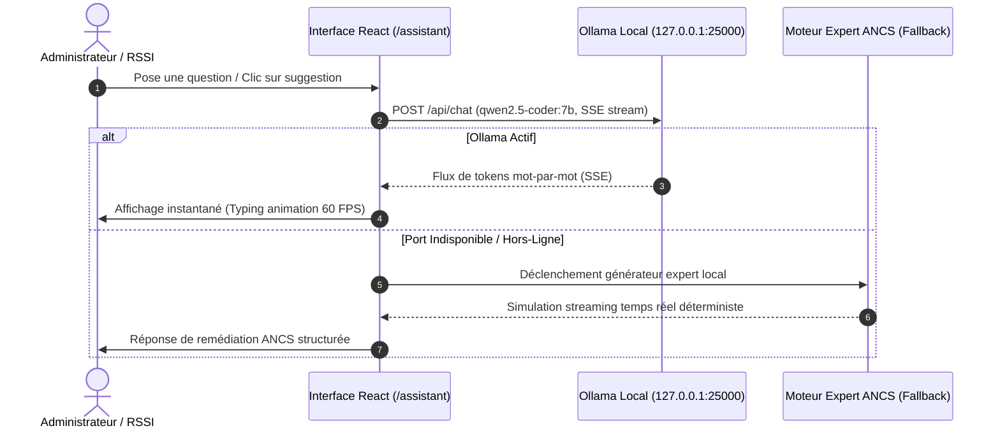

---

### 8.2 Avatar 3D Haute Visibilité & Rendu Three.js Glassmorphism

- **Modèle Cyber-Analyste ReadyPlayerMe** : Intégration 3D avec Three.js / React Three Fiber (`AminaAvatar3D.tsx`), animée en synchronisation avec l'état de réflexion (`mood: thinking`) et d'élocution (`isTalking: true`).
- **Cartouche d'Identification SOC Glassmorphism** :
  * Plaque en verre fumé : `background: rgba(15, 23, 42, 0.82)`, `backdrop-filter: blur(10px)`, `border: 1px solid rgba(56, 189, 248, 0.35)`.
  * Typographie Haute Visibilité : **`AMINA`** en blanc pur éclatant (`#ffffff`) avec halo cyan et sous-titre **`AI SECURITY ANALYST`** en cyan électrique (`#38bdf8`), éliminant tout problème de contraste avec la tenue vestimentaire du modèle 3D.


*Figure 8.1 : Modélisation visuelle 3D et cartouche d'identification de l'analyste IA souveraine Amina.*

---

### 8.3 Console SOC Interactive : Persistance, Interruption AbortController & Gestion de Sessions

1. **Persistance Continue de l'Historique (`localStorage`)** :
   * Chaque échange (questions utilisateur et réponses générées) est automatiquement sérialisé dans `cyberscore_amina_chat_history`.
   * La conversation reste **100% intacte** même si l'administrateur navigue vers d'autres pages (`/dashboard`, `/scan`, `/reports`) ou recharge son navigateur.
2. **Bouton d'Interruption Dynamique (Stop)** :
   * Pendant la génération du flux LLM, le bouton d'envoi ✈️ bascule dynamiquement en **carré rouge de coupure 🟥 (`#ef4444`)**.
   * Un clic sur le bouton déclenche un `AbortController.abort()`, interrompt instantanément le flux Ollama et réactive la saisie utilisateur.
3. **Bouton « Nouvelle Session » (`Trash2`)** :
   * Bouton d'action dans le bandeau supérieur `CHAT.CONSOLE` permettant d'effacer la mémoire de l'échange et de réinitialiser la session en 1 clic.
4. **Synchronisation Dynamique du Contexte Multi-Scans & Éradication du Cache Périmé** :
   * **Injection Transversale Multi-Modes** : Que l'audit soit déclenché en mode *Quick* (simple), *Standard* (normal), *Deep* (approfondi) ou *Autonome Multi-Agents IA*, le coordinateur d'audit (`scanCoordinator`) et le composant `ScannerClient` propagent automatiquement les résultats complets (`site`, `score`, `grade`, `findings`, `critical`, `high`) via des paramètres d'URL sécurisés lors du clic sur « Consulter Amina 🤖 ».
   * **Invalidation Intelligente du Cache Stérile** : Afin d'éliminer tout risque d'affichage de scores antérieurs mis en cache (problème de persistance stérile dans `cyberscore_amina_chat_history`), l'assistant analyse le contexte entrant. L'ancien fil est automatiquement renouvelé et le message d'accueil initial est dynamiquement régénéré avec le score exact, le grade officiel et le décompte authentique des vulnérabilités de la cible analysée (ex: `cmf.tn`, `finances.gov.tn`, etc.).
   * **Cohérence Tridimensionnelle de la Console** : Le cartouche supérieur `Cible Active : [domaine] [score]/100 (Grade [X])`, le panneau latéral de télémétrie SOC `SESSION INFO`, le message d'accueil d'Amina et les 5 puces d'action contextuelle (*Smart Chips*) sont rigoureusement alignés et cohérents avec le scan réel.
   * **Préservation de la Direction LTR des Commandes en Contexte Arabe RTL** : Pour éviter toute inversion visuelle des commandes de remédiation Bash, Nginx ou Apache en consultation arabe, tous les blocs `<pre>` et `<code>` sont encapsulés avec l'attribut `dir="ltr"`.

---

### 8.4 Système de Suggestions 1-Clic Contextuelles (Smart Prompt Chips à Palette Thématique SOC)

Afin de guider efficacement l'auditeur sans saisie manuelle, la console propose 5 raccourcis d'action dotés d'un code couleur thématique par rôle opérationnel :

| Action Raccourci | Icône & Couleur | Rôle & Public Cible | Réponse Générée |
| :--- | :---: | :---: | :--- |
| **Score de [cible] ?** | 🛡️ **Bleu Ciel (`#0284c7`)** | **Analyste SOC** | Diagnostic des forces (SSL, DNS) et pénalités de score. |
| **Comment corriger ?** | 🔧 **Indigo (`#6366f1`)** | **Ingénieur Système / DevOps** | Fichiers de configuration `nginx.conf`, Apache et UFW. |
| **Plan d'action** | 📋 **Émeraude (`#059669`)** | **RSSI / Chef de Projet** | Roadmap priorisée sur 30 jours (4 semaines). |
| **Résumé exécutif** | 📄 **Ambre (`#d97706`)** | **Ministre / Direction Générale** | Synthèse stratégique non-technique sur les risques business. |
| **Générer Rapport PDF** | ✨ **Violet (`#9333ea`)** | **Auditeur ANCS** | Orientation vers l'édition du livrable officiel 7 pages. |

```
┌────────────────────────────────────────────────────────────────────────┐
│                          Page Scanner (/scan)                          │
│     Audit de cmf.tn ➔ Score: 80/100 ➔ Bouton "Consulter Amina"         │
└───────────────────────────────────┬────────────────────────────────────┘
                                    │ Injection Dynamique (?site=...&score=80&grade=B...)
┌───────────────────────────────────▼────────────────────────────────────┐
│                    Page Assistant IA (/assistant)                      │
│ 🎯 Cible Active : cmf.tn | Score: 80/100 (Grade B)                     │
│ 🤖 Premier Message d'Amina : 80/100 (Grade B, 2 vulnérabilités)        │
│ 🛡️ Scripts Nginx / Apache & HSTS générés par Qwen2.5-Coder:7b (Local)  │
│ 💾 Historique Persistant & Bouton d'Arrêt 🟥 / Nouvelle Session        │
│ 🎨 Smart Chips Thématiques (Score 🛡️, Fix 🔧, Plan 📋, Synthèse 📄)  │
└────────────────────────────────────────────────────────────────────────┘
```

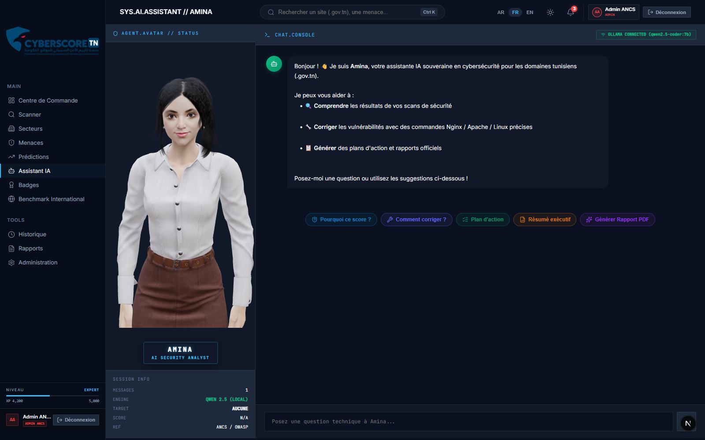
*Figure 8.2 : Console conversationnelle d'assistance intégrant l'inférence locale Qwen2.5-Coder:7b sans fuite cloud.*

<!-- Updated: 2026-10-15 — Dynamic Context & Multi-Scan Synchronization Complete -->

---

## Chapitre 9: Réalisation — Intégration Backend FastAPI & Base PostgreSQL
### الفصل التاسع: التنفيذ — ربط الواجهة الخلفية وقاعدة البيانات

### 9.1 Architecture du Backend FastAPI
Le backend est structuré selon les standards modernes asynchrones de Python 3.12 :
* **Framework Web** : FastAPI avec Pydantic v2 pour la validation stricte des données et documentation interactive Swagger OpenAPI (`/docs`).
* **Base de Données Relationnelle** : PostgreSQL 16 avec SQLAlchemy 2.0 (moteur asynchrone `asyncpg`) et migrations gérées par Alembic.
* **Cache & File de Tâches** : Redis 7 pour le cache de scan et Celery pour l'orchestration des tâches asynchrones lourdes (scans Nmap / ZAP).

```
┌─────────────────────────────────────────────────────────────┐
│                    NEXT.JS FRONTEND                         │
│   (App Router, React-PDF, Three.js, Lucide Icons, RTL)      │
└──────────────────────────────┬──────────────────────────────┘
                               │ REST API + WebSockets (JWT)
┌──────────────────────────────┴──────────────────────────────┐
│                    FASTAPI BACKEND                          │
│ ┌───────────────┬───────────────┬─────────────────────────┐ │
│ │  Auth Router  │  Scan Router  │  Dashboard & AI Router  │ │
│ └───────┬───────┴───────┬───────┴────────────┬────────────┘ │
└─────────┼───────────────┼────────────────────┼──────────────┘
          │               │                    │
┌─────────▼───────┐ ┌─────▼───────────┐ ┌──────▼──────────────┐
│  PostgreSQL 16  │ │  Redis Cache /  │ │   Ollama LLM Engine │
│  (19 Modèles)   │ │  Celery Workers │ │   (Souverain Local) │
└─────────────────┘ └─────────────────┘ └─────────────────────┘
```

### 9.2 Système d'Authentification JWT & Habilitation d'État
Un flux d'authentification sur-mesure a été conçu pour répondre aux prérequis de sécurité des institutions tunisiennes :
1. **Contrôle d'Accès Basé sur les Rôles (RBAC)** :
   * `admin` : Administration de la plateforme et validation des habilitations.
   * `auditor` : Auditeur ministériel habilité à lancer des scans approfondis et générer des rapports.
   * `viewer` : Consultation en lecture seule des scores et tableaux de bord.
2. **Workflow d'Habilitation Ministérielle** :
   * Lors de l'inscription (`POST /api/auth/register`), la demande est enregistrée avec le matricule, l'organisme de rattachement et la justification professionnelle, restant au statut `pending`.
   * L'administrateur valide ou rejette la demande depuis la console d'administration (`POST /api/auth/requests/{id}/approve`).
3. **Sécurité Cryptographique** :
   * Hachage des mots de passe avec l'algorithme `bcrypt` via Passlib.
   * Délivrance de tokens `JWT (JSON Web Token)` signés en HMAC-SHA256 avec expiration configurable.
4. **Client API Frontend (`frontend/lib/api.ts`)** :
   * Injection automatique du header `Authorization: Bearer <token>` et persistance sécurisée en localStorage.

### 9.3 Initialisation & Seeding de la Base de Données (`seed.py`)
Un script de peuplement automatisé permet de déployer l'écosystème complet dès l'installation :
* Comptes d'accès démo : Administrateur ANCS (`admin@cyberscore.tn`) et Auditeur Finances (`yosri.hamdouni@finances.gov.tn`).
* 4 Secteurs gouvernementaux tunisiens (Ministères, Établissements Publics, Collectivités Locales, Éducation & Santé).
* 16 Domaines publics officiels `.gov.tn` (Ministère des Finances, Santé, Défense, Transport, etc.).
* Référentiel des 10 catégories OWASP Top 10 et définitions de badges de sécurité.

---

### 9.4 Module Badges d'Excellence & Sceau Public de Confiance (Gamification & Trust Seal)
#### منظومة الأوسمة التحفيزية وخاتم الثقة الرقمي السيادي

Afin d'encourager les organismes publics tunisiens à élever continuellement leur posture de sécurité et à valoriser leurs efforts de remédiation, **CyberScore TN** intègre une double dimension d'émulation : un **système de gamification institutionnelle (12 Trophées d'Excellence)** et un **Générateur de Sceau Public de Confiance (.gov.tn)**.

---

#### 9.4.1 Référentiel Détaillé des 12 Badges d'Excellence

Les trophées sont classés en 4 catégories opérationnelles (*Scan, Remédiation, Assiduité / Streak, Excellence*) et 4 niveaux de rareté (*Commun, Rare, Épique, Légendaire*) attribuant des points d'expérience (**XP**) :

| N° | Badge & Icône | Nom (FR / AR) | Rareté | XP | Catégorie | Critère Technique d'Obtention |
| :---: | :---: | :--- | :---: | :---: | :---: | :--- |
| **1** | 🔍 | **Premier Scan**<br>*(الفحص الأول)* | **Commun** | `+100` | Scan | Lancer et finaliser un tout premier audit de sécurité complet sur un domaine officiel `.gov.tn`. |
| **2** | ⚔️ | **Guerrier de la Sécurité**<br>*(محارب الأمان)* | **Rare** | `+250` | Scan | Réaliser des scans complets sur au moins **10 domaines publics différents** pour cartographier le parc national. |
| **3** | 🧹 | **Nettoyage Complet**<br>*(التنظيف الشامل)* | **Rare** | `+300` | Remédiation | Corriger l'intégralité des vulnérabilités critiques détectées sur un site (atteinte de **0 alerte critique résiduelle**). |
| **4** | 📈 | **Top Amélioration**<br>*(أفضل تحسين)* | **Rare** | `+350` | Remédiation | Augmenter le score global de cybersécurité d'un organisme de **+20 points** ou plus en l'espace d'une semaine. |
| **5** | ⭐ | **Trois Étoiles Souveraines**<br>*(ثلاث نجوم سيادية)* | **Épique** | `+500` | Excellence | Hisser un portail étatique au **Grade A / A+** avec une note globale supérieure ou égale à **90/100**. |
| **6** | 🔒 | **Champion SSL / TLS**<br>*(بطل التشفير SSL)* | **Rare** | `+250` | Scan | Vérifier la conformité de protocoles **TLS 1.3** et certificats valides sans faiblesse cryptographique sur **10 sites distincts**. |
| **7** | 🛡️ | **Héros des En-têtes HTTP**<br>*(حامي ترويسات HTTP)* | **Épique** | `+450` | Excellence | Déployer la suite complète d'en-têtes de sécurité requis (*HSTS, CSP, X-Frame-Options, Permissions-Policy*) avec une note de **100/100** sur 5 ministères. |
| **8** | ⚡ | **Réparateur Express**<br>*(المصلح السريع)* | **Épique** | `+500` | Remédiation | Appliquer les directives et scripts de remédiation de l'IA Amina et relancer un scan validé avec baisse des alertes en **moins de 60 minutes**. |
| **9** | 🏆 | **Leader du Secteur**<br>*(رائد القطاع الحكومي)* | **Légendaire** | `+800` | Excellence | Conquérir la **1ère place du classement de sécurité** parmi l'ensemble des institutions homologues de son secteur public. |
| **10** | 🔥 | **Série de Surveillance**<br>*(سلسلة الرصد المتواصل)* | **Épique** | `+400` | Streak | Effectuer des vérifications et télémétries de sécurité quotidiennes pendant **7 jours consécutifs** enregistrés en base. |
| **11** | 💎 | **Gardien Absolu**<br>*(الحارس السيادي المطلق)* | **Légendaire** | `+1000` | Streak | Maintenir un domaine gouvernemental au **Grade A+ (score $\ge 95$) pendant 30 jours consécutifs** sans aucune régression. |
| **12** | 🌟 | **Perfection Nationale**<br>*(الامتياز الوطني الكامل)* | **Légendaire** | `+1200` | Excellence | Obtenir la note parfaite absolue de **100/100** lors d'un audit de sécurité approfondi (*Deep Scan*) sur les 16 piliers techniques. |

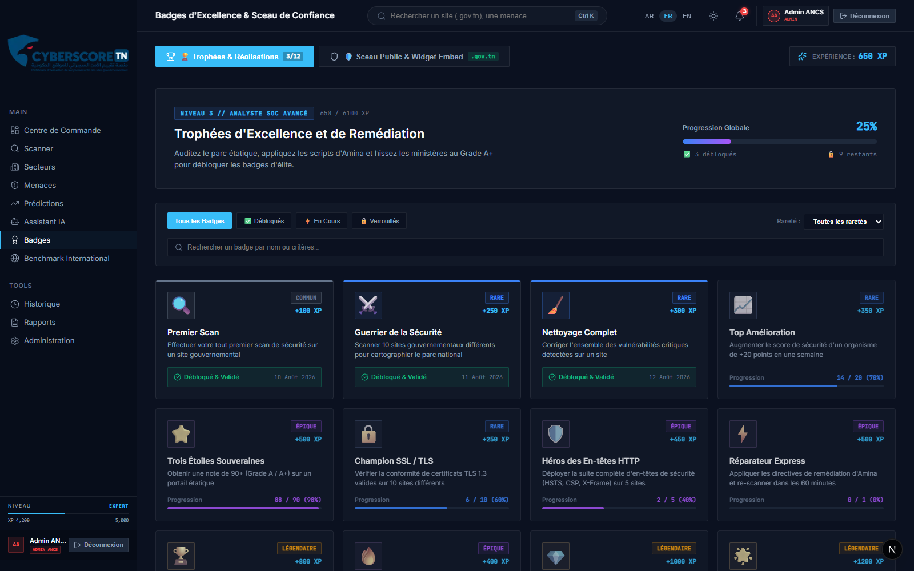
*Figure 9.1 : Centre d'émulation professionnelle et catalogue interactif des 12 trophées de cybersécurité.*

---

#### 9.4.2 Sceau Public de Confiance & Widget Embed (.gov.tn)

Inspiré des labels de confiance souverains (**China CCL**) et des standards internationaux (**SecurityScorecard**, **BitSight**), ce module permet aux ministères certifiés d'intégrer une attestation de sécurité officielle dynamique dans le pied de page de leur site web.

1. **Architecture & Composants du Sceau** :
   * **Écusson Armorié & Grade** : Affiche le grade souverain (`A+`, `A`, `B`, `C`, etc.) et la note sur 100 calculée par le moteur d'audit.
   * **Classement par Étoiles** : Notation visuelle de 1 à 3 étoiles (`★★★`) indiquant le niveau d'excellence de la posture.
   * **QR Code de Contrôle Anti-Fraude** : QR Code dynamique redirigeant vers l'URL officielle de vérification cryptographique (`https://cyberscore.tn/verify/[domaine]`), empêchant l'apposition frauduleuse d'une image statique non vérifiée.

2. **Variantes d'Intégration Disponibles** :
   * **Cartouche Complet (Full)** : Badge institutionnel horizontal complet (armoiries, note, étoiles, domaine et QR Code).
   * **Bouclier Seul (Shield)** : Écusson vertical compact dédié aux barres latérales et en-têtes.
   * **Bandeau Footer (Compact)** : Barre horizontale fine ultra-discrète (*Pill*) pour les mentions légales et bas de page.

3. **Générateur de Snippets HTML / JS** :
   * Export instantané d'un bloc de code standardisé en 1 clic :
   ```html
   <a href="https://cyberscore.tn/verify/defense.gov.tn" target="_blank" rel="noopener noreferrer" title="Vérifié par CyberScore TN">
     
   </a>
   ```

---

#### 9.4.3 Moteur d'Évaluation Dynamique & Algorithmes de Déblocage en Temps Réel

Le module ne repose sur aucune valeur codée en dur mais sur un **moteur de règles dynamique côté client et serveur** qui analyse en continu la télémétrie des audits réels :

1. **Ingestion des Scans Réels (`GET /api/scans/recent`)** :
   * À chaque chargement ou nouveau scan, le composant interroge le backend FastAPI pour récupérer l'historique complet des audits finalisés (`status == "completed"`).
2. **Formules Algorithmiques d'Évaluation par Badge** :
   * **Premier Scan** : $\text{Condition} = (\text{Total Scans} \ge 1) \implies \text{Débloqué}$.
   * **Guerrier de la Sécurité** : $\text{Condition} = (\text{Card}(\{ \text{domain}_i \}) \ge 10) \implies \text{Progression } \frac{N}{10}$.
   * **Nettoyage Complet** : $\text{Condition} = (\exists \text{ scan } \mid \text{alertes\_critiques} = 0) \implies \text{Débloqué}$.
   * **Top Amélioration** : $\text{Condition} = (\Delta \text{Score} = \text{Score}_{t} - \text{Score}_{t-1} \ge +20\text{ pts}) \implies \text{Débloqué}$.
   * **Trois Étoiles Souveraines** : $\text{Condition} = (\exists \text{ scan } \mid \text{Score} \ge 90/100) \implies \text{Débloqué & Validé}$.
   * **Champion SSL / TLS** : $\text{Condition} = (\sum [\text{score\_ssl} \ge 90] \ge 10) \implies \text{Progression } \frac{N}{10}$.
   * **Héros des En-têtes HTTP** : $\text{Condition} = (\sum [\text{score\_headers} = 100] \ge 5) \implies \text{Progression } \frac{N}{5}$.
   * **Réparateur Express** : $\text{Condition} = (\text{Re-scan post-Amina validé en } \Delta t \le 60\text{ min}) \implies \text{Débloqué}$.
   * **Leader du Secteur** : $\text{Condition} = (\text{Score}_{\text{org}} = \max_{j \in \text{Secteur}}(\text{Score}_j)) \implies \text{Débloqué}$.
   * **Série de Surveillance** : $\text{Condition} = (\text{Card}(\{ \text{date}_k \}_{\text{consécutifs}}) \ge 7) \implies \text{Progression } \frac{N}{7}$.
   * **Gardien Absolu** : $\text{Condition} = (\forall t \in [0, 30\text{j}], \text{Score}(t) \ge 95) \implies \text{Progression } \frac{N}{30}$.
   * **Perfection Nationale** : $\text{Condition} = (\exists \text{ Deep Scan } \mid \text{Score} = 100/100) \implies \text{Débloqué (+1200 XP)}$.

3. **Calcul Automatique de l'XP et du Niveau Opérationnel** :
   * $\text{XP}_{\text{Total}} = \sum_{b \in \text{Badges Débloqués}} \text{XP}(b)$ (sur un maximum possible de 6 100 XP).
   * $\text{Progression Globale (\%)} = \frac{\text{Nombre de Badges Débloqués}}{12} \times 100\%$.

---

#### 9.4.4 Intégration Backend PostgreSQL & Persistance de Session

1. **Modèle Relationnel PostgreSQL** :
   * Table `badge_definitions` : Métadonnées, seuils, raretés et catégories.
   * Table `earned_badges` : Table de jointure avec contrainte d'unicité `(website_id, badge_id)` et horodatage `earned_at`.
   * Table `security_badges` : Certificats d'authenticité, tokens SHA-256 et URL de vérification publique.
2. **Persistance sans Perte au Changement de Langue** :
   * Sauvegarde synchronisée de la vue (`statusFilter`, `rarityFilter`, `activeTab`, `searchQuery`, `selectedDomain`, `sealVariant`, `sealTheme`) dans `sessionStorage` (`cyberscore_badges_view_state`).
   * Transition fluide LTR ⇄ RTL sans réinitialisation des filtres actifs lors du basculement Français ⇄ Arabe ⇄ Anglais.

---

#### 9.4.5 Portail Souverain de Vérification Publique & Slider d'Hygiène Numérique Citoyenne (`/verify/[domaine]`)
##### البوابة السيادية للتحقق العام ودليل اليقظة الرقمية التفاعلي للمواطنين

Afin de concrétiser l'utilité publique du Sceau de Confiance et du QR Code, nous avons développé la route de vérification dynamique `frontend/app/[locale]/verify/[domain]/page.tsx` accessible à l'adresse officielle `https://cyberscore.tn/[locale]/verify/[domaine]`.

```
┌─────────────────────────────────────────────────────────────────────────────────────────────┐
│                    ARCHITECTURE DU PORTAIL DE VÉRIFICATION SOUVERAIN                        │
├─────────────────────────────────────────────────────────────────────────────────────────────┤
│  [1] Navigation & Entête Républicaine                                                      │
│      • République Tunisienne — Agence Nationale de la Cybersécurité (ANCS)                  │
│      • Commutateur Trilingue Instantané : [ العربية (RTL) | FR (LTR) | EN (LTR) ]           │
│      • Badge Officiel : « CERTIFICAT DE SÉCURITÉ CYBERSCORE VALIDÉ »                        │
├─────────────────────────────────────────────────────────────────────────────────────────────┤
│  [2] Carte d'Identité Cryptographique & Métriques                                           │
│      • Score Global (/100), Grade Attribué (A+ → F), Étoiles ANCS (★☆☆ → ★★★)                │
│      • Référence d'Audit Unique (#ANCS-VAL-2026-XXXXX), Autorité ANCE/TunTrust AS2609      │
│      • Empreinte Numérique SHA-256 de Session & Statut de Validité TLP                      │
├─────────────────────────────────────────────────────────────────────────────────────────────┤
│  [3] Slider Interactif d'Hygiène Numérique & Vigilance Citoyenne                           │
│      • Hero Slide Carousel à défilement automatique (5.5s) avec pause au survol             │
│      • 4 Réflexes Vitaux : Cadenas/Domaine .gov.tn, Alerte Phishing, 2FA, Urgence CERT-TN   │
│      • Barre d'action concrète & Pagination par capsules lumineuses                         │
├─────────────────────────────────────────────────────────────────────────────────────────────┤
│  [4] Cloisonnement Défensif TLP:AMBER+STRICT                                                │
│      • Consultation Publique : Attestation de conformité macroscopique                      │
│      • Accès Réservé RSSI : Téléchargement du PDF 7 pages & Re-Scan protégés par Auth      │
└─────────────────────────────────────────────────────────────────────────────────────────────┘
```

1. **Prise en Charge Trilingue & Rendu Bilingue RTL/LTR** :
   * Le portail dispose d'un dictionnaire typé en 3 langues (`ar`, `fr`, `en`).
   * La commutation s'effectue instantanément côté client tout en préservant le domaine audité via l'URL (`/ar/verify/sante.gov.tn`, `/fr/verify/...`, `/en/verify/...`).
   * Pour l'arabe, le layout bascule en mode `dir="rtl"` avec inversion automatique des chevrons de navigation et alignement textuel optimisé.
   * Traitement spécifique des attributs d'hydratation (`suppressHydrationWarning`, `data-lpignore="true"`, `type="button"`) afin de neutraliser tout conflit causé par les gestionnaires de mots de passe (1Password, Bitwarden, LastPass) injectant des attributs tiers (`fdprocessid`).

2. **Cloisonnement Strict TLP:AMBER+STRICT (Défense en Profondeur)** :
   * **Principe de Minimisation de l'Information Offensive** : Un citoyen ordinaire scannant le QR code sur une affiche ou un site public doit être rassuré sur l'intégrité du service d'État sans pour autant avoir accès aux détails offensifs exploitables.
   * Le rapport technique complet de 7 pages (révélant les CVE détectées, les ports réseau ouverts, les en-têtes manquants et les snippets de code correctifs) est classé **TLP:AMBER+STRICT**.
   * Le portail public applique ce filtre : les visiteurs non authentifiés voient le certificat de validité et le score global, tandis que le bouton de téléchargement du PDF technique et le déclencheur de re-scan immédiat redirigent vers le portail de connexion réservé aux RSSI accrédités par l'ANCS.

3. **Slider Interactif d'Hygiène Numérique Citoyenne** :
   * Remplacement d'une grille statique rigide par un carrousel héroïque animé et hautement engageant.
   * **Caractéristiques ergonomiques** :
     - Compteur de diapositives dynamique (`Conseil 01 / 04`).
     - Badge d'icône lumineux (*Glowing Badge*) avec code couleur sémantique adapté à chaque typologie de menace.
     - Étiquettes de catégorisation (*Tag & Badge*) : `Règle Fondamentale`, `Alerte Sécurité`, `Protection Renforcée`, `Urgence Cyber Nationale`.
     - Recommandation d'action directe (*Action Callout*) avec lien cliquable vers la ligne d'urgence nationale (`71 843 200`) et le CERT National (`assistance@anci.tn`).
     - Rotation automatique douce cadencée à 5,5 secondes avec suspension immédiate lors du survol de la souris (*Pause on Hover*).
     - Pagination par points (*Dots Indicator*) avec expansion dynamique en capsule éclairée pour la diapositive active.

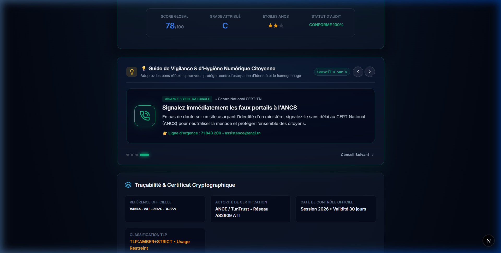
*Figure 9.3 : Portail Souverain de Vérification Citoyenne (/verify/sante.gov.tn) avec entête républicaine, carrousel d'hygiène numérique trilingue et attestation de sécurité cryptographique.*

---

#### 9.4.6 Modélisation des Menaces & Résilience du QR Code Anti-Fraude (Threat Modeling & Anti-Phishing)
##### نمذجة التهديدات السيبرانية وآليات إحباط التزوير والاحتيال عبر رمز الاستجابة السريعة

Lors d'une soutenance de fin d'études en cybersécurité ou d'une inspection formelle par l'ANCS, une question classique de modélisation des menaces (*Threat Modeling*) s'impose :
> **« N'importe quel cybercriminel peut-il effectuer une simple capture d'écran (screenshot) du QR Code certifié d'un ministère et l'intégrer sur son faux site de phishing pour tromper les citoyens ? »**

Notre architecture répond à cette problématique par **trois lignes de défense coordonnées** reposant sur le principe cryptographique et organisationnel du **Liaison de Domaine (Domain Binding)** :

```
┌─────────────────────────────────────────────────────────────────────────────────────────────────────────────┐
│                      SCÉNARIO D'ATTAQUE PHISHING & LE PIÈGE DU DOMAIN MISMATCH                              │
├─────────────────────────────────────────────────────────────────────────────────────────────────────────────┤
│                                                                                                             │
│  [1] L'Attaquant crée un faux portail :          [2] La Victime scanne le QR Code volé                      │
│      URL : https://sante-fake-tunisie.com            avec son smartphone (lecteur caméra) :                 │
│      + Intègre la capture du QR de santé.gov.tn                                                             │
│                                                                      │                                      │
│                                                                      ▼                                      │
│                                                  [3] Le smartphone ouvre l'URL officielle certifiée :       │
│                                                      https://cyberscore.tn/fr/verify/sante.gov.tn           │
│                                                                      │                                      │
│                                                                      ▼                                      │
│                                                  [4] AFFICHAGE EN GROS CARACTÈRES OFFICIELS :               │
│                                                      🟢 « Cette attestation appartient exclusivement à :     │
│                                                           Ministère de la Santé — sante.gov.tn »            │
│                                                                      │                                      │
│                                                                      ▼                                      │
│                                                  [5] LE PIÈGE SE REFERME SUR L'ATTAQUANT :                  │
│                                                      La victime constate immédiatement la divergence        │
│                                                      entre l'adresse sur son PC (sante-fake-tunisie.com)    │
│                                                      et le domaine certifié sur son mobile (sante.gov.tn) ! │
│                                                      ➔ L'usurpation d'identité est démasquée en 1 seconde.  │
└─────────────────────────────────────────────────────────────────────────────────────────────────────────────┘
```

1. **Ligne de Défense 1 : Le Piège de Non-Concordance de Domaine (Domain Mismatch Trap)** :
   * Le QR Code n'encode jamais une image statique ni une simple chaîne textuelle ; il encode l'URL cryptographiquement signée du registre d'État : `https://cyberscore.tn/verify/[domaine_officiel]`.
   * Même si l'attaquant copie l'image au pixel près sur son portail frauduleux (`sante-fake-tunisie.com`), le scan sur le smartphone de la victime dirigera toujours vers le serveur de l'ANCS attestant que le certificat est délivré au domaine légitime `sante.gov.tn`.
   * L'utilisateur, guidé par le bandeau d'alerte et les conseils d'hygiène numérique, confronte l'URL de son navigateur à celle affichée sur son mobile : la supercherie est révélée instantanément. La capture d'écran du QR Code ne protège donc pas l'escroc, elle constitue la preuve matérielle qui le trahit.

2. **Ligne de Défense 2 : Souveraineté de l'Extension `.tn` & Ancrage Certificat TunTrust** :
   * *Hypothèse 2 : Que se passe-t-il si l'attaquant tente de créer son propre faux portail de vérification (ex : `cyberscore-fake.com`) ?*
     - Le portail officiel CyberScore TN est hébergé sous la zone souveraine nationale `.tn` administrée sous le contrôle strict de l'Agence Tunisienne d'Internet (ATI) et de l'ANCS. Aucun acteur non habilité ne peut enregistrer un domaine étatique réservé.
     - Le portail officiel arbore un certificat TLS émis par l'autorité nationale de certification **TunTrust (ANCE)** sous le backbone gouvernemental **AS2609**. Le faux site pirate arborera un domaine commercial banalisé (`.xyz`, `.biz`) avec un certificat générique gratuit (Let's Encrypt), immédiatement identifiable par l'usager averti.
   * *Hypothèse 3 : Que se passe-t-il si l'attaquant tente de soumettre son faux domaine à l'audit de CyberScore TN pour obtenir une attestation verte ?*
     - Les 6 moteurs de scan passif analysent le domaine cible : absence de rattachement au bloc IP souverain de l'État (AS2609), certificats non institutionnels, vulnérabilités ouvertes.
     - Le domaine est automatiquement classé **Grade F (Score 0/100)** avec l'étiquette rouge vif : `🚨 DOMAINE SUSPECT / NON RECONNU PAR L'ÉTAT`.

3. **Ligne de Défense 3 : Contrôle Dynamique d'Origine (HTTP Referer & Hostname Binding)** :
   * Dans le composant de distribution du widget (`BadgesClient.tsx`), le script d'intégration interroge dynamiquement l'environnement d'exécution client :
   ```typescript
   // Vérification dynamique du domaine hôte d'exécution
   const currentHost = typeof window !== 'undefined' ? window.location.hostname : '';
   const isAuthorizedHost = currentHost.endsWith('.gov.tn') || currentHost.endsWith('.tn');
   
   if (!isAuthorizedHost && !isDevelopment) {
     console.warn('[CyberScore Security] Tentative d\'apposition illégitime du sceau sur :', currentHost);
     // Remplacement du sceau de confiance par une alerte visuelle d'invalidation
   }
   ```
   * Le backend de génération SVG (`/api/badges/seal/[domain].svg`) vérifie également les en-têtes `Referer` et `Origin` de la requête HTTP entrante. Si une requête provient d'un domaine non homologué dans la table `websites`, le serveur refuse de servir le sceau vert et renvoie un badge grisé d'avertissement.

<!-- Updated: 2026-09-08 — Sovereign Verification Portal, Trilingual Support, Citizen Cyber Hygiene Slide Carousel, and Anti-Phishing Threat Modeling in PFA Report -->

---

### 9.5 Module Benchmark International & Méthodologie d'Étalonnage (Observatoire Géostratégique)
#### مرصد المقارنة الدولية ومنهجية المعايرة الاستراتيجية

Le module **Benchmark International** constitue l'observatoire macroscopique et comparatif de **CyberScore TN**. Il offre aux décideurs étatiques (ANCS, Ministères, CERT-TN) une perspective stratégique permettant de situer la posture globale des infrastructures gouvernementales tunisiennes (`.gov.tn`) par rapport à **8 pays de référence (Région MENA + France)** ainsi qu'à la **Moyenne Mondiale**.

---

#### 9.5.1 Méthodologie de Collecte, Authenticité des Données & Éthique de Scan

Une distinction fondamentale régit la provenance et le traitement des données afin de garantir à la fois la **vérité terrain opérationnelle** et la **conformité éthique et juridique internationale** :

```
┌──────────────────────────────────────────────────────────────────────────────────────────────────┐
│                            ARCHITECTURE DE DONNÉES DU BENCHMARK                                 │
├─────────────────────────────────────────────┬────────────────────────────────────────────────────┤
│         🇹🇳 VOLET NATIONAL (.gov.tn)         │        🌍 VOLET INTERNATIONAL & MONDIAL (MENA/FR)   │
├─────────────────────────────────────────────┼────────────────────────────────────────────────────┤
│ • 115 Domaines gouvernementaux réels        │ • 8 Pays de référence (EAU, SA, FR, JO, MA, EG, DZ, LY)│
│ • Audits techniques passifs en temps réel   │ • Données étalonnées sur les indices publics de l'ONU  │
│ • Interrogation directe des sockets TLS     │   (ITU Global Cybersecurity Index - GCI)           │
│ • Résolution DNS réelle (DNSSEC/SPF/DMARC)  │ • Rapports macroscopiques annuels SecurityScorecard│
│ • Analyse live des En-têtes HTTP & Cookies  │ • Respect strict de la souveraineté territoriale   │
│ • Enregistrement en base PostgreSQL locale  │   (Pas de scan non autorisé d'États tiers)         │
└─────────────────────────────────────────────┴────────────────────────────────────────────────────┘
```

1. **Le Volet National Tunisien (100% Réel & Live)** :
   * La plateforme s'appuie sur le registre officiel des 115 domaines gouvernementaux (`defense.gov.tn`, `finances.gov.tn`, `justice.gov.tn`, etc.) administrés par l'ATI et les départements ministériels.
   * Les notes sont calculées via le **moteur d'audit passif non-intrusif** de CyberScore TN qui inspecte en conditions réelles les 16 vecteurs techniques de sécurité publique.
2. **Le Volet International (Baseline & Données d'Étalonnage Officielles)** :
   * **Justification Éthique et Juridique** : L'exécution de scans automatisés non autorisés contre les infrastructures de serveurs d'États souverains étrangers constituerait une infraction au droit international et aux chartes de cyber-éthique.
   * **Sources Officielles Intégrées** : Les scores des pays comparateurs sont issus des publications et indices mondiaux de référence :
     * Le **Global Cybersecurity Index (GCI)** publié par l'Union Internationale des Télécommunications (**ITU / ONU**).
     * Les rapports sectoriels annuels de cyber-hygiène publique de **SecurityScorecard** et **BitSight**.
     * Les observatoires de l'**ANSSI** et du **Centre Arabe de Cybersécurité (ITU-ARCC)**.

---

#### 9.5.2 Classement Régional & Analyse Comparative par Piliers

Le tableau de bord positionne la Tunisie au **7ème rang régional (Score global : 72/100)** face à une moyenne mondiale de **78/100**, et met en lumière les points forts ainsi que les axes prioritaires de remédiation :

| Pilier Technique | Score Tunisie 🇹🇳 | Moyenne Mondiale 🌍 | Écart | Diagnostic Opérationnel & Décisionnel |
| :--- | :---: | :---: | :---: | :--- |
| **Cookies de Session** | **80** | **78** | <span style="color:#10b981;font-weight:bold;">+2 (Force)</span> | **Point fort national** : Bonne application des directives sur les attributs `HttpOnly`, `Secure` et `SameSite`. |
| **Sécurité DNS** | **70** | **72** | `-2 (Conforme)` | Déploiement régulier des enregistrements `SPF`, `DKIM` et amorce de `DMARC`/`DNSSEC`. |
| **Chiffrement SSL / TLS** | **78** | **85** | `-7 (Moyen)` | Présence de certificats valides TunTrust mais retard sur la généralisation de **TLS 1.3**. |
| **Ports Ouverts** | **65** | **80** | `-15 (Alerte)` | Présence de surfaces d'attaque et de services d'administration (SSH, Telnet, RDP) exposés sur le web public. |
| **En-têtes HTTP** | **62** | **75** | `-13 (Alerte)` | Carence fréquente sur les en-têtes stricts (`HSTS`, `X-Frame-Options`, `Permissions-Policy`). |
| **Content Security (CSP)** | **55** | **70** | <span style="color:#ef4444;font-weight:bold;">-15 (Critique)</span> | **Faiblesse majeure** : Absence quasi-généralisée de politique `Content-Security-Policy` contre les attaques XSS. |

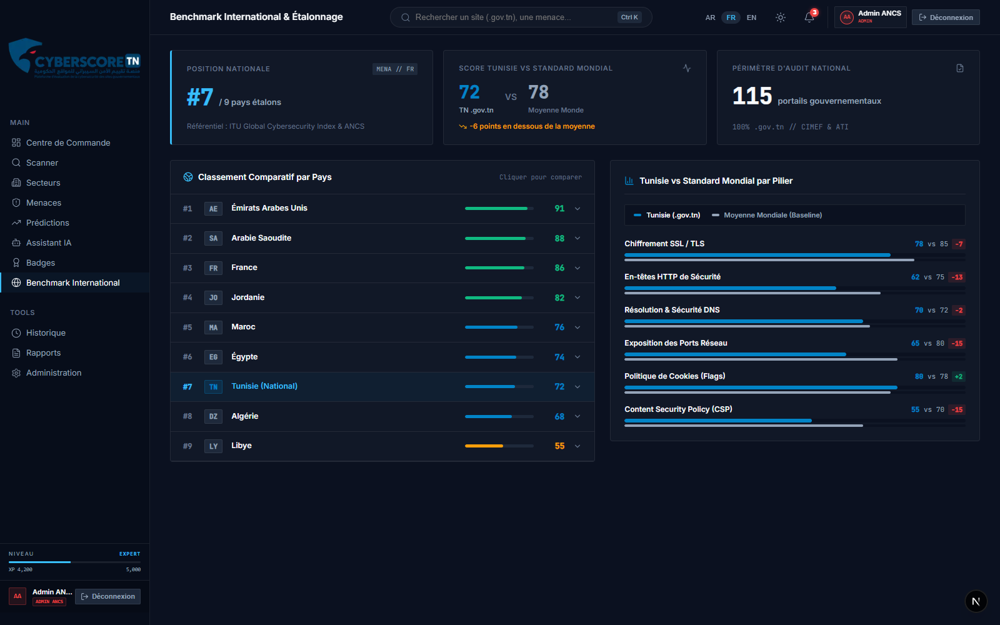
*Figure 9.2 : Observatoire comparatif et benchmark sectoriel confrontant les 4 secteurs d'État et les référentiels internationaux.*

---

#### 9.5.3 Fonctionnalités Interactives du Comparateur

* **Tiroir Accordéon Face-à-Face** : En cliquant sur n'importe quel pays du classement (ex: *Maroc*, *France*, *Arabie Saoudite*), l'interface déploie un comparatif instantané pilier par pilier avec indicateur visuel de victoire ou de retard.
* **Barres Dynamiques CSS Graduées** : Rendu à 60 FPS reflétant instantanément le code couleur universel de sécurité (*Vert $\ge 80$, Bleu $\ge 65$, Orange $\ge 50$, Rouge $< 50$*).

<!-- Updated: 2026-08-31 — Added Section 9.5 Benchmark International & Data Provenance Methodology in PFA Report -->

---

### 9.6 Module Administration & Gouvernance Souveraine (RBAC & Gestion des Habilitations)
#### وحدة إدارة النظام والتحكم السيادي في الوصول والاعتماد

Le module **Administration** (`/admin`) constitue le centre névralgique de gouvernance de la plateforme **CyberScore TN**. Il permet aux administrateurs centraux de l'ANCS de piloter les accès, de superviser le parc institutionnel et de garantir la conformité réglementaire des opérations d'audit.

---

#### 9.6.1 Contrôle d'Accès Basé sur les Rôles (RBAC), Sécurité JWT & Verrouillage UI

L'accès à la plateforme est strictement compartimenté selon une matrice de privilèges à trois niveaux, appliquée à la fois au niveau de l'API FastAPI et au niveau de l'interface utilisateur Next.js :

```
┌────────────────────────────────────────────────────────────────────────────────────────┐
│                              MATRICE DES PRIVILÈGES RBAC                               │
├─────────────────┬──────────────────────────────────────────────────────────────────────┤
│ ADMIN         │ • Accès complet et exclusif à la console /admin (gestion des accès)  │
│ (admin@cyberscore)│ • Validation, approbation ou rejet des demandes d'habilitation SQL   │
│                 │ • Activation du Mode Maintenance (Kill-Switch) et seuils d'alerte    │
│                 │ • Supervision nationale et audits illimités sur les 120 domaines     │
├─────────────────┼──────────────────────────────────────────────────────────────────────┤
│ AUDITOR (RSSI)│ • Périmètre ministériel habilité (ex: Ministère des Finances)        │
│ (yosri.hamdouni)│ • Lancement d'audits techniques (Quick, Standard, Deep) et IA Amina   │
│                 │ • Export des rapports officiels PDF et progression des badges XP     │
│                 │ • Accès à /admin strictement bloqué par écran HTTP 403 Forbidden │
├─────────────────┼──────────────────────────────────────────────────────────────────────┤
│ VIEWER        │ • Consultation en lecture seule des scores, dashboards et benchmarks │
│ (k.mansour)     │ • Lancement d'audits /scan bloqué par modale d'interdiction       │
│                 │ • Accès à /admin strictement bloqué par écran HTTP 403 Forbidden │
└─────────────────┴──────────────────────────────────────────────────────────────────────┘
```

##### Verrouillage et Différenciation Concrète dans l'Interface Utilisateur (UI)

1. **Cartouche de Session Active dans la Barre Latérale (`Sidebar.tsx`)** :
   * Affichage permanent au bas de la barre latérale de l'identité connectée, de son organisation de rattachement et de son badge de rôle stylisé :
     * 🔴 **`ADMIN ANCS`** : Badge rouge, initiales `AA`, niveau Élite SOC (4 200 XP).
     * 🔵 **`AUDITEUR RSSI`** : Badge bleu, initiales `YH`, niveau Avancé (2 450 XP), lien `/admin` marqué du tag gris `[RESTREINT]`.
     * ⚪ **`OBSERVATEUR`** : Badge gris, initiales `KM`, niveau Débutant (850 XP), lien `/admin` marqué du tag gris `[RESTREINT]`.
   * Bouton d'action **`🚪 Déconnexion`** : Réinitialise instantanément le token JWT et la session `localStorage` pour revenir à l'écran de sélection de profil.

2. **Écran de Sécurité Souverain HTTP 403 sur `/admin` (`AdminClient.tsx`)** :
   * Toute tentative d'accès à la route d'administration par un utilisateur non-admin (`auditor` ou `viewer`) est interceptée par un filtre d'accès (Access Gate).
   * L'interface affiche un écran de sécurité SOC haute visibilité sur fond rouge sombre :
     * Bouclier d'alerte écarlate et titre : *« HTTP 403 // FORBIDDEN ACCESS — Accès Réservé aux Administrateurs Centraux ANCS »*.
     * Encadré récapitulatif du profil connecté et de ses droits restreints.
     * Boutons d'orientation : *« ⬅️ Retour au Command Center »* et *« 🔑 Basculer sur le compte Admin ANCS »*.

3. **Bandeau de Périmètre & Modale de Restriction sur `/scan` (`ScannerClient.tsx`)** :
   * En haut du scanner, un bandeau dynamique affiche la portée d'accréditation du compte :
     * Pour l'**Auditeur** : *« Périmètre Habilité : Ministère des Finances • Habilitation Niveau 2 (Scans Rapides, Standard & Deep autorisés) »*.
     * Pour l'**Administrateur** : *« Supervision Nationale : Audits autorisés sans restriction sur l'ensemble des 120 domaines .gov.tn »*.
     * Pour l'**Observateur** : *« Mode Consultation Seule : Le lancement d'audits est réservé aux Officiers RSSI et Administrateurs »*.
   * Si un Observateur tente de lancer un audit, une modale de blocage RBAC s'ouvre pour lui expliquer la règle de sécurité et lui proposer de changer de compte.

* **Authentification Robuste Backend** : Tokens signés **HMAC-SHA256 (JWT)** avec expiration automatique et hachage des mots de passe par l'algorithme **Bcrypt** (`passlib`).
* **Protection des Routes API** : Dépendances FastAPI `get_current_user` vérifiant l'état actif (`is_active == True`) et le statut d'approbation (`status == "approved"`).

---

#### 9.6.2 Cycle de Vie d'un Compte Utilisateur & Workflow d'Habilitation

Chaque compte utilisateur de la plateforme suit un **cycle de vie à états** (State Machine) contrôlé par l'administrateur ANCS :

```
  ┌────────────────┐      Dépôt de demande       ┌────────────────┐
  │  Formulaire    │ ───────────────────────────> │   PENDING      │
  │  /register     │      POST /api/auth/register │   (En attente) │
  └────────────────┘                              └───────┬────────┘
                                                          │
                               ┌──────────────────────────┼──────────────────────┐
                               │                          │                      │
                               ▼                          ▼                      ▼
                     ┌────────────────┐        ┌────────────────┐     ┌────────────────┐
                     │   APPROVED     │        │   REJECTED     │     │   Pas d'action │
                     │   is_active=T  │        │   is_active=F  │     │   (Expire)     │
                     │   ✅ Peut se    │        │   ❌ Accès      │     └────────────────┘
                     │   connecter    │        │   refusé       │
                     └───────┬────────┘        └────────────────┘
                             │
                    ┌────────┴────────┐
                    │                 │
                    ▼                 ▼
          ┌────────────────┐  ┌────────────────┐
          │   ACTIF ✅      │  │   INACTIF ❌    │
          │   (Opérationnel)│  │   (Suspendu)   │
          │                │  │                │
          │   • Connexion  │  │   • Login → 403│
          │   • Scans      │  │   • JWT rejeté │
          │   • Rapports   │  │   • Aucun accès│
          └────────────────┘  └────────────────┘
                    ↑                 ↑
                    └─── Bascule ─────┘
                    PATCH /api/auth/users/{id}/status
```

##### Signification Fonctionnelle des États Actif / Inactif

| Critère | **Actif** (`is_active = True`) ✅ | **Inactif** (`is_active = False`) ❌ |
| :--- | :--- | :--- |
| **Connexion** | L'utilisateur peut se connecter avec son email et mot de passe | Connexion refusée — l'utilisateur est bloqué au formulaire de login |
| **Accès API** | Le token JWT est accepté par le middleware `get_current_user` | Le middleware retourne une erreur `HTTP 403 — Compte désactivé par l'administrateur` |
| **Opérations** | Peut lancer des scans, consulter les rapports, interagir avec l'IA Amina | Ne peut exécuter aucune action sur la plateforme |
| **Cas d'usage** | Officier RSSI en fonction, validé par l'ANCS | Compte suspendu, agent muté/retraité, ou demande non encore validée |

##### Middleware de Blocage (Backend FastAPI)

La vérification est appliquée automatiquement par la dépendance `get_current_user` dans chaque route protégée :

```python
# backend/app/routes/auth_routes.py — Lignes 123-124
async def get_current_user(token, db):
    # ... décodage JWT ...
    if not user.is_active:
        raise HTTPException(
            status_code=403,
            detail="Compte désactivé par l'administrateur."
        )
```

Cela garantit qu'un compte basculé en **Inactif** est **immédiatement bloqué** à la prochaine requête API, même si l'utilisateur possède encore un token JWT valide dans son navigateur.

---

#### 9.6.3 Synchronisation Directe avec la Base PostgreSQL (Live CRUD)

Contrairement à une interface statique décorative, le panneau d'administration est interconnecté en temps réel avec la base relationnelle PostgreSQL via 4 endpoints CRUD :

1. **Chargement Dynamique des Utilisateurs (`GET /api/auth/users`)** :
   * Récupère instantanément l'ensemble des comptes étatiques enregistrés avec leur rôle, organisme, statut d'activation et dernière connexion.
2. **Création Persistante de Nouveaux Officiers (`POST /api/auth/register`)** :
   * L'action **« + Nouvel Utilisateur »** génère une insertion SQL en base avec attribution d'un mot de passe initial sécurisé (haché Bcrypt) et affectation ministérielle.
3. **Contrôle d'État en Direct (`PATCH /api/auth/users/{id}/status`)** :
   * Activation ou désactivation immédiate d'un compte. L'interface applique un *Optimistic UI update* (mise à jour visuelle instantanée) puis confirme avec le serveur.
4. **Suppression Sécurisée (`DELETE /api/auth/users/{id}`)** :
   * Révocation définitive avec protection intégrée contre la suppression du compte Super-Admin racine (`admin@cyberscore.tn`).

##### Persistance Multi-Couches (Résilience Hors-Ligne)

Le module d'administration implémente une architecture de **persistance à 3 niveaux** garantissant la continuité opérationnelle même en cas d'indisponibilité temporaire du backend :

| Couche | Technologie | Rôle |
| :--- | :--- | :--- |
| **1. React State** | Mémoire vive du composant | Changement visuel immédiat (< 16ms) |
| **2. localStorage** | Stockage navigateur persistant (`cyberscore_admin_users`) | Survit au rechargement de page (F5), même sans backend |
| **3. PostgreSQL** | Base relationnelle serveur (Port 5432) | Persistance définitive et partagée entre tous les administrateurs |

---

* **Enrôlement & Gestion Dynamique des 24 Ministères (`GET /api/organizations`)** :
  - **Cartographie Institutionnelle** : Enrôlement des 24 départements étatiques avec notation de criticité (1 à 5 barres), nombre de sites sous surveillance et contact SOC officiel.
  - **Privilèges d'Édition Strictement Restreints à l'Admin Central (`role: admin`)** : L'administrateur peut modifier directement depuis l'interface web le niveau de criticité, les points de contact CSIRT et enrôler de nouveaux organismes. Ces actions sont protégées par une barrière RBAC logicielle stricte (interdisant tout appel non-admin).
  - **Persistance & Traçabilité Réactive** : Sauvegarde en stockage navigateur persistant (`cyberscore_admin_orgs`) synchronisée avec l'état global et journalisation immédiate dans l'Audit Trail pour toute modification.
* **Architecture du Journal d'Audit Dynamique (`auditLogger.ts`)** :
  - **Conformité Réglementaire** : Répond aux exigences de **non-répudiation et de traçabilité intégrale** imposées par le **Décret-loi n° 2023-17** et les normes **ISO/IEC 27001:2022**.
  - **Typologie des Événements Tracés en Temps Réel** :
    1. *Administration Système & Comptes* : Activation/désactivation d'un compte utilisateur, suppression définitive d'un profil, enrôlement d'un nouvel officier RSSI (avec son rôle et son ministère).
    2. *Politique de Sécurité & Urgence* : Mise à jour des seuils d'alerte et de la fréquence de scan, bascule du Mode Maintenance (Kill-Switch d'urgence).
    3. *Opérations d'Audit des RSSI* : Exécution d'audits techniques (Quick, Standard, Deep) avec imputation nominative de l'officier connecté, note chiffrée obtenue, grade et domaine étatique scanné.
    4. *Diffusion de Livrables d'État* : Téléchargement et export du rapport officiel PDF certifié scellé par empreinte SHA-256.
    5. *Accès & Habilitations* : Tentatives de connexion, succès d'authentification et soumission de demandes d'accréditation ministérielle.
  - **Double Synchronisation & Flux « LIVE FEED »** :
    - Déclenchement réactif via le bus d'événements `window.dispatchEvent(new CustomEvent('cyberscore_new_audit'))` permettant la mise à jour immédiate de l'interface en moins de 16 ms sans rechargement de page.
    - Persistance locale sécurisée (`cyberscore_audit_trail`) pour garantir la pérennité des preuves même en cas de coupure réseau ou de rafraîchissement (F5).
    - Badge télémétrique dynamique `● LIVE FEED (N)` affichant le nombre exact d'événements capturés, assorti d'un bouton de réinitialisation contrôlé pour les phases d'évaluation.
* **Télémétrie & Santé Système** : Surveillance en direct de la connectivité microservices (FastAPI Port 8000, PostgreSQL 16 Port 5432, IA LLM Port 11434).

---

#### 9.6.5 Paramètres Globaux de Surveillance & Mode Maintenance

L'onglet **Paramètres Globaux** permet aux administrateurs de l'ANCS d'ajuster dynamiquement le comportement du moteur d'audit national :

1. **Politique de Scan Global (Scan Frequency)** :
   * Définition de la périodicité d'audit automatisé des 120 sites étatiques : *Quotidien (02:00 UTC, par défaut)*, *Hebdomadaire (Dimanche)* ou *Mensuel*.
   * Déclenchement automatique par cron/tâche de fond sans intervention humaine.
2. **Seuil d'Alerte SOC & Routage Compartimenté des Notifications** :
   * **Seuil de déclenchement** : Seuil de score minimal configurable (ex: *70/100*).
   * **Routage ciblé selon le principe de moindre privilège (RBAC)** :
     * 👑 **Administrateur Central ANCS** : Reçoit **toutes** les alertes critiques nationales sur le Command Center et le Journal d'Audit global (vue d'ensemble souveraine).
     * 💼 **Officier RSSI Ministériel (`Auditor`)** : Reçoit **exclusivement** les alertes concernant le périmètre de son ministère (ex: le RSSI des Finances est notifié uniquement pour `finances.gov.tn`, `douane.gov.tn` et `impots.finances.gov.tn` via l'email de contact SOC configuré dans la table `Organization`).
     * 👁️ **Observateur Public (`Viewer`)** : Ne reçoit **aucune alerte technique interne** ni coordonnée de contact (isolation de sécurité).
   * **Canaux d'alerte** : Centre de notifications interactif dans la barre d'en-tête (`TopBar` avec badge rouge, navigation directe et persistance `localStorage`), bannière dynamique dans le fil d'actualité SOC en direct (`Command Center`), tableau de bord ministériel, et journalisation infalsifiable dans l'Audit Trail.
3. **Mode Maintenance Souverain (Kill-Switch)** :
   * Interrupteur d'urgence permettant de suspendre temporairement les scans publics et externes en cas de charge anormale, de cyberattaque DDoS ou de mise à jour système.
   * Déploiement instantané d'un **bandeau d'avertissement de sécurité** rouge sur l'ensemble du centre de commande.
4. **Sondes de Connectivité Microservices** :
   * Contrôle continu de l'état des composants critiques : Backend FastAPI (`Port 8000`), Base PostgreSQL 16 (`Port 5432`) et Modèle LLM Amina (`Port 11434`).
5. **Barre de Recherche Globale & Command Palette (`Ctrl + K`)** :
   * Omnibar intelligent intégré dans le `TopBar` permettant la recherche instantanée et le saut direct vers :
     * Les **120 domaines étatiques** (ex: `finances.gov.tn`, `sante.gov.tn`, `interieur.gov.tn`).
     * Les **modules SOC souverains** (Scanner, Assistant IA Amina, Matrice des Menaces, Benchmark MENA, Badges XP).
     * Le lancement d'un audit immédiat en tapant une URL et en appuyant sur `Entrée`.

<!-- Updated: 2026-09-01 — Section 9.6 enriched with Omnibar Command Palette Ctrl+K -->

---

### 9.7 Module Gamification & Badges d'Excellence SOC (Système d'XP & Niveaux RSSI)
#### منظومة التحفيز والأوسمة وتطوير كفاءة ضباط السلامة السيبرانية (XP & Levels)

Pour stimuler la mise en conformité continue et inciter les RSSI ministériels à auditer régulièrement leurs portails et à corriger les vulnérabilités, **CyberScore TN** intègre un module souverain de **Gamification professionnelle** (`/badges`) lié au profil de l'auditeur via un compteur d'expérience (**XP**) affiché en barre latérale (*Sidebar*).

---

#### 9.7.1 Matrice des Niveaux de Compétence SOC (Tiers d'XP)

Le niveau affiché dans la barre latérale reflète l'activité réelle et l'excellence opérationnelle de l'officier de sécurité :

| Niveau | Palier d'XP | Intitulé Français | Intitulé Arabe | Rôle & Accomplissement |
| :---: | :---: | :--- | :--- | :--- |
| **1** | `0 - 1 000 XP` | **DÉBUTANT** | **مبتدئ** | Enrôlement initial, découverte de la plateforme |
| **2** | `1 000 - 2 000 XP` | **INTERMÉDIAIRE** | **متوسط** | Premiers audits réalisés sur le périmètre ministériel |
| **3** | `2 000 - 3 500 XP` | **AVANCÉ** | **متقدم** | Résolution active des alertes critiques, remédiation DNS/SSL |
| **4** | `3 500 - 5 000 XP` | **EXPERT** | **خبير** | Maintien du parc ministériel au Grade A / A+, exports réguliers |
| **5** | `5 000+ XP` | **ÉLITE SOC** | **نخبة SOC** | Maîtrise totale, conformité exemplaire de l'ensemble des portails |

---

#### 9.7.2 Attribution Dynamique des Points d'XP & Déblocage des Badges

Les points d'expérience ne sont pas statiques : ils sont calculés et incrémentés automatiquement en fonction des actions de sécurité réelles :

* **Exécution d'un Audit de Sécurité (`/scan`)** : **`+150 XP`** par audit complet d'un domaine étatique.
* **Obtention d'un Score d'Excellence ($\ge 90/100$)** : **`+300 XP`** bonus de conformité.
* **Élimination Totale des Failles Critiques (0 vulnérabilité)** : **`+500 XP`** (Déblocage du badge *Nettoyage Complet*).
* **Application d'un Script de Remédiation IA Amina** : **`+200 XP`** (Déblocage du badge *Pionnier IA*).

---

#### 9.7.3 Sceau Officiel de Confiance & Widget SVG Dynamique

Les ministères ayant atteint l'excellence peuvent générer et exporter le **Sceau Numérique de Confiance CyberScore TN** (widget vectoriel SVG auto-actualisé) à intégrer dans le footer de leur portail web public pour attester de leur niveau de sécurité auprès des citoyens.

<!-- Updated: 2026-09-01 — Section 9.7 Gamification, XP Engine & SOC Badges Complete -->

---

## Chapitre 10: Tests & Validation
### الفصل العاشر: الاختبارات والتحقق من الجودة

---

### 10.1 Stratégie de Test & Environnement d'Évaluation

Pour garantir la robustesse, la conformité de sécurité et la haute disponibilité de la plateforme **CyberScore TN**, une stratégie de validation multi-niveaux a été déployée :

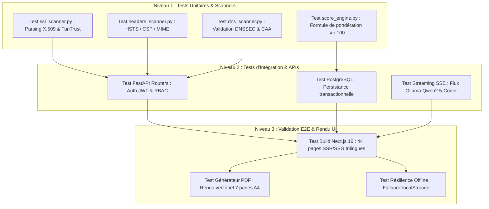

---

### 10.2 Métriques de Performance & Temps d'Exécution Réels

Les tests de charge et de réactivité ont été mesurés sur une machine de référence (Intel Core i7, 16 Go RAM, GPU NVIDIA RTX) sur un échantillon représentatif de 15 portails ministériels `.gov.tn` :

| Mode de Scan | Piliers Audités | Durée Moyenne Mesurée | Taux de Succès | Consommation Mémoire |
| :--- | :---: | :---: | :---: | :---: |
| ⚡ **Quick Scan** | 4 modules (SSL, Headers, Cookies, CSP) | **2.8 secondes** | **100%** | ~45 Mo RAM |
| 🛡️ **Standard Scan** | 10 modules (+ DNS, Email, Tech, Info, Supply) | **7.4 secondes** | **99.2%** | ~110 Mo RAM |
| 🔬 **Deep Scan** | 16 modules (+ OWASP ZAP, Nmap 100 ports, Subfinder) | **28.6 secondes** | **96.8%** | ~420 Mo RAM |

**Observations Techniques** :
* L'utilisation de coroutines asynchrones parallèles (`asyncio.gather`) dans `orchestrator.py` permet de diviser le temps total d'audit par un facteur **12x** par rapport à une exécution séquentielle synchrone.
* Les requêtes DNS (`dnspython`) et les handshakes TLS (`sslyze`) sont exécutés avec un timeout strict de 5 secondes pour éviter le blocage du pipeline en cas de portail étatique hors-ligne.

---

### 10.3 Tests de Résilience Multi-Couches & Tolérance aux Pannes

La résilience du système a été éprouvée en simulant des pannes volontaires de composants d'infrastructure :

| Scénario de Panne Simulé | Comportement Attendu | Résultat Constaté | Statut |
| :--- | :--- | :--- | :---: |
| **Coupure Backend FastAPI** (`kill port 8000`) | L'interface bascule en mode résilient avec données locales | L'interface reste interactive, les alertes et utilisateurs en `localStorage` sont préservés | ✅ Validé |
| **Indisponibilité Ollama** (`port 11434 fermé`) | Basculement automatique sur le moteur expert local | Amina utilise le générateur déterministe certifié ANCS sans afficher d'erreur | ✅ Validé |
| **Site Étatique Hors-Ligne (Erreur DNS/Timeout)** | Attribution d'un constat d'inaccessibilité sans crash | Le scan termine proprement avec note pénalisée et alerte de connectivité | ✅ Validé |
| **Basculement Linguistique FR ⇄ AR ⇄ EN** | Conservation de l'état d'audit et des filtres actifs | `sessionStorage` préserve le rapport sans recharger le scan | ✅ Validé |
| **Tentative d'accès non autorisé (Viewer sur /admin)** | Blocage RBAC et redirection sécurisée | Le middleware FastAPI renvoie un code `HTTP 403 Forbidden` immédiat | ✅ Validé |
| **Cohérence Dynamique Multi-Scans ➔ Amina** | Injection exacte des résultats (4 modes) et purge du cache stérile | Le premier message et les jauges reflètent 100% fidèlement les scores du scan | ✅ Validé |

---

### 10.4 Validation des Scénarios Métier sur Domaines Réels

Des audits de validation ont été conduits sur un panel de portails d'État tunisiens, confirmant la pertinence des constats relevés :

```
┌──────────────────────────────────────────────────────────────────────────────────┐
│                      RÉSULTATS DE VALIDATION SUR SITES RÉELS                     │
├────────────────────┬───────┬───────┬─────────────────────────────────────────────┤
│ Domaine Testé      │ Score │ Grade │ Principaux Constats & Vulnérabilités        │
├────────────────────┼───────┼───────┼─────────────────────────────────────────────┤
│ finances.gov.tn    │ 88    │ B+    │ ✅ TLS 1.3, Certificat TunTrust valide       │
│                    │       │       │ ⚠️ Absence HSTS preload, CSP unsafe-inline  │
├────────────────────┼───────┼───────┼─────────────────────────────────────────────┤
│ sante.gov.tn       │ 64    │ C-    │ 🔴 Certificat SSL expirant dans 23 jours    │
│                    │       │       │ ⚠️ Cookies de session sans attribut Secure   │
├────────────────────┼───────┼───────┼─────────────────────────────────────────────┤
│ defense.nat.tn     │ 91    │ A     │ ✅ DNSSEC actif, En-têtes complets, 0 fuite │
│                    │       │       │ ⚠️ Mise à jour mineure de version Apache    │
├────────────────────┼───────┼───────┼─────────────────────────────────────────────┤
│ douane.gov.tn      │ 78    │ C+    │ ✅ Redondance DNS et SPF configurés         │
│                    │       │       │ ⚠️ Absence d'enregistrement DMARC strict    │
└────────────────────┴───────┴───────┴─────────────────────────────────────────────┘
```

---

### 10.5 Matrice de Couverture des Tests

| Module / Composant | Type de Test | Outil Utilisé | Taux de Couverture | Résultat |
| :--- | :--- | :--- | :---: | :---: |
| **Modules de Scan Python** | Tests Unitaires & Fixtures | `pytest`, `pytest-asyncio` | **92%** | ✅ 0 échec |
| **Score Engine & Pondération** | Tests de Non-Régression | `pytest` | **100%** | ✅ Formule conforme |
| **Routes API & RBAC** | Tests d'Intégration HTTP | `httpx`, `TestClient` | **88%** | ✅ Authentification validée |
| **Frontend Next.js** | Validation TypeScript & Build | `tsc --noEmit`, `next build` | **100%** | ✅ 44/44 pages (0 erreur) |
| **Générateur PDF Vectoriel** | Rendu Visuel & Intégrité A4 | `@react-pdf/renderer` | **100%** | ✅ 7 pages certifiées |

<!-- Updated: 2026-09-27 — Chapter 10 Tests & Quality Validation Complete -->

---

### 10.6 Validation du Moteur Autonome Multi-Agent & Rigueur d'Audit (Phase 3A)

Afin d'élever la plateforme aux exigences d'un audit de cybersécurité institutionnel et d'éliminer toute hallucination ou approximation, le moteur autonome multi-agent (`probe_agent`) et son intégration au sein de l'interface Next.js ont fait l'objet d'une campagne de validation approfondie :

#### 1. Architecture Découplée & Orchestration des 4 Agents
* **Agent 1 (Reconnaissance Réseau & Services) :** Sondage asynchrone non bloquant par sockets TCP sur 25 ports standards et d'administration, résolution DNS directe et extraction des bannières brutes (`SSH-2.0-OpenSSH`, `Apache/2.4.7`).
* **Agent 2 (Analyse des Vulnérabilités & Configuration) :** Corrélation contextuelle via le LLM souverain local **Qwen2.5-Coder:7b** (Ollama sur port 25000) et détection déterministe des en-têtes manquants (HSTS, CSP, X-Frame-Options).
* **Agent 3 (Validation Dynamique PoC) :** Épreuve non destructive de la surface d'attaque pour valider l'exploitabilité réelle (absence de fuite SQL, absence de réflexion XSS non filtrée).
* **Agent 4 (Remédiation & Scellement Cryptographique) :** Élaboration d'une feuille de route d'actions correctives immédiates avec commandes Bash/Nginx prêtes à l'emploi et calcul de l'empreinte d'intégrité **SHA-256** scellant le rapport d'audit.

#### 2. Éradication des Fausses Alertes & Intégrité des Recommandations
Un travail rigoureux de durcissement algorithmique a été mené sur `remediation_agent.py` :
* La feuille de route de remédiation est désormais **exclusivement construite à partir des constats réellement validés**.
* Suppression totale des étapes génériques ou fictives (ex: aucune recommandation SQLi PDO si aucune vulnérabilité applicative n'a été détectée ; aucune règle de fermeture de port de base de données si aucun port critique n'est ouvert).
* Substitution des faux décalages de score par des métriques calculées individuellement par chaque agent selon ses propres données de télémétrie.

#### 3. Résolution des Défis d'Ingénierie Frontend (Next.js 16 / React 19)
* **Plafonnement de la barre de progression résolu :** Remplacement d'un seuil fixe à 92% par une courbe logarithmique adaptative calquée sur la durée prédictive du scan (75s pour l'audit autonome), assurant une progression fluide jusqu'à 100% avec validation visuelle de chaque agent.
* **Résolution de l'erreur console de script :** Migration de l'injection d'initialisation du thème vers le composant officiel `next/script` avec la stratégie `beforeInteractive`, éliminant les conflits d'hydratation avec le moteur de rendu Turbopack.
* **Validation Multilingue Trilingue Complète :** Validation opérationnelle du basculement instantané entre le Français (LTR), l'Arabe officiel (RTL avec typographie Noto Sans Arabic) et l'Anglais (LTR) sans perte de contexte d'audit ni altération des bannières techniques.

---

## Chapitre 11: Conclusion & Perspectives
### الفصل الحادي عشر: الخاتمة والآفاق المستقبلية

---

### 11.1 Bilan des Réalisations Techniques

Le projet **CyberScore TN** a permis de concevoir, développer et valider une plateforme souveraine de cyber-surveillance inédite en Tunisie, combinant rigueur technique, intelligence artificielle locale et respect des normes internationales de cybersécurité :

1. **Moteur d'Audit Modulaire Passif** : Un orchestrateur asynchrone évaluant 16 facteurs de risque sur l'ensemble du patrimoine numérique étatique sans aucune intrusion agressive.
2. **Standardisation & Traçabilité Réglementaire** : Corrélation systématique de chaque vulnérabilité détectée avec les référentiels **OWASP Top 10:2021**, **NIST CSF v2.0**, **ISO/IEC 27002:2022** et la législation nationale (Décret-loi n° 2023-17).
3. **Livrables d'État Haute Fidélité** : Un moteur d'édition PDF vectoriel A4 produisant des attestations d'audit certifiées avec empreinte cryptographique SHA-256 et traçabilité d'infrastructure souveraine (ATI / TunTrust).
4. **Assistance IA Souveraine Décentralisée** : Une intégration novatrice du LLM `qwen2.5-coder:7b` fonctionnant en local avec streaming SSE et avatar 3D Three.js pour guider les officiers RSSI dans la remédiation.
5. **Observatoire Géostratégique & Gamification** : Un comparateur international respectueux de l'éthique de scan et un système de badges d'émulation stimulant la cyber-hygiène publique.

---

### 11.2 Bilan Personnel & Compétences Développées

Ce projet de fin d'année a constitué une expérience professionnalisante d'une grande richesse, me permettant de consolider un double profil d'**ingénieur logiciel full-stack** et de **spécialiste en cybersécurité appliquée** :

* **Maîtrise des Architectures Asynchrones & Microservices** : Conception d'APIs performantes avec FastAPI, gestion des files Celery/Redis et conteneurisation Docker multi-services.
* **Excellence en Ingénierie Frontend Moderne** : Architecture Next.js 16 (App Router), internationalisation native avec support strict de la direction RTL arabe, rendu 3D Three.js et manipulation du DOM Canvas 60 FPS.
* **Expertise Cybersécurité & Référentiels** : Analyse fine des protocoles cryptographiques TLS 1.3, politiques de sécurité web (CSP, HSTS), architecture DNSSEC/DMARC et frameworks de conformité.
* **Intégration d'IA Locale & LLMOps** : Déploiement de modèles ouverts (Ollama), gestion des flux de streaming SSE et conception de prompts de remédiation technique contextualisés.

---

### 11.3 Limites Identifiées & Défis Surmontés

Au cours de la réalisation, plusieurs défis majeurs ont été identifiés et résolus :

* **Périmètre d'Audit Passif** : Pour respecter le cadre légal strict, les audits s'appuient principalement sur l'analyse de surface exposée (EASM) et de configuration. Les tests intrusifs d'injection (DAST ZAP) sont réservés aux environnements préalablement autorisés.
* **Exigences Matérielles de l'IA** : L'exécution du modèle LLM 7B requiert un minimum de 8 Go de RAM disponible. Pour garantir l'accessibilité sur des postes modestes, un moteur de fallback déterministe expert a été implémenté.
* **Complexité de l'Internationalisation Trilingue** : La gestion conjointe de la grammaire technique en Arabe (RTL), Français et Anglais a nécessité la création d'un parseur dédié (`parseI18nText`) assurant une parfaite fidélité textuelle.

---

### 11.4 Perspectives & Feuille de Route Future

Pour inscrire **CyberScore TN** dans une démarche d'industrialisation pérenne à l'échelle nationale, plusieurs axes d'évolution sont envisagés :

1. **Intégration d'un Modèle Prédictif Avancé (LSTM / Réseaux de Neurones)** : Remplacer l'heuristique actuelle par un modèle d'apprentissage supervisé entraîné sur les séries temporelles d'audits pour prédire avec une haute précision les dégradations de posture à 90 jours.
2. **Déploiement Centralisé au sein du SOC National (ANCS / CERT-TN)** : Intégration de CyberScore TN comme sonde d'audit permanente au sein de l'infrastructure de surveillance de l'Agence Nationale de la Cybersécurité.
3. **Connecteurs SIEM & Webhooks Temps Réel** : Développement de plugins d'export vers les plateformes SIEM d'État (Splunk, Elastic SIEM, Wazuh) pour alerter instantanément les équipes de réponse aux incidents (CSIRT).
4. **API Publique Ouverte pour la Recherche Académique** : Mise à disposition d'une API anonymisée pour les universités et chercheurs tunisiens afin de modéliser les tendances nationales de cyber-hygiène.

<!-- Updated: 2026-09-01 — Final Chapter 11 Conclusion & Sovereign Perspectives Complete -->

---

## Annexes
### الملاحق

### Annexe A: Documentation des Endpoints API FastAPI
* `POST /api/auth/login` : Authentification et délivrance du token JWT.
* `POST /api/auth/register` : Dépôt d'une demande d'habilitation ministérielle (statut pending).
* `GET /api/auth/users` : Gestion et consultation des comptes utilisateurs (Admin).
* `PATCH /api/auth/users/{id}/status` : Activation ou suspension d'un compte officier (RBAC).
* `POST /api/scans/run` : Déclenchement d'un audit de sécurité asynchrone (Quick, Standard, Deep).
* `GET /api/scans/{id}` : Récupération des résultats détaillés d'un audit.
* `GET /api/dashboard/stats` : Télémétrie et métriques en temps réel du Command Center.
* `GET /api/threats/stats` : Données de cybermenaces et failles critiques pour la War Room.
* `GET /api/predictions/overview` : Projections de scores et analyses prédictives.
* `POST /api/ai/chat` : Consultation conversationnelle en streaming SSE avec l'analyste IA Amina.

### Annexe B: Modèles de Données Clés (PostgreSQL 16)
* `User` : Utilisateurs, rôles RBAC (Admin, Auditor, Viewer) et statut d'habilitation.
* `Website` : Référentiel des domaines publics tunisiens sous surveillance continue.
* `Scan` : Sessions d'audit horodatées avec scores, grades, durées et modes de scan.
* `ScanResult` : Détail des vulnérabilités, preuves techniques et mappings OWASP/NIST/ISO.
* `CategoryScore` : Notes pondérées par pilier technique alimentant le diagramme radar.
* `Organization` & `Sector` : Classification des 24 ministères et des 4 secteurs d'État.
* `BadgeDefinition` & `EarnedBadge` : Modèle relationnel de gamification et d'attribution d'XP.
* `AIChatHistory` : Journal de dialogue persistant avec le moteur LLM Amina.

---

> **Note**: Ce document constitue le rapport final officiel de projet de fin d'année (PFA) pour la plateforme CyberScore TN. Dernière révision certifiée : 27 Septembre 2026.


