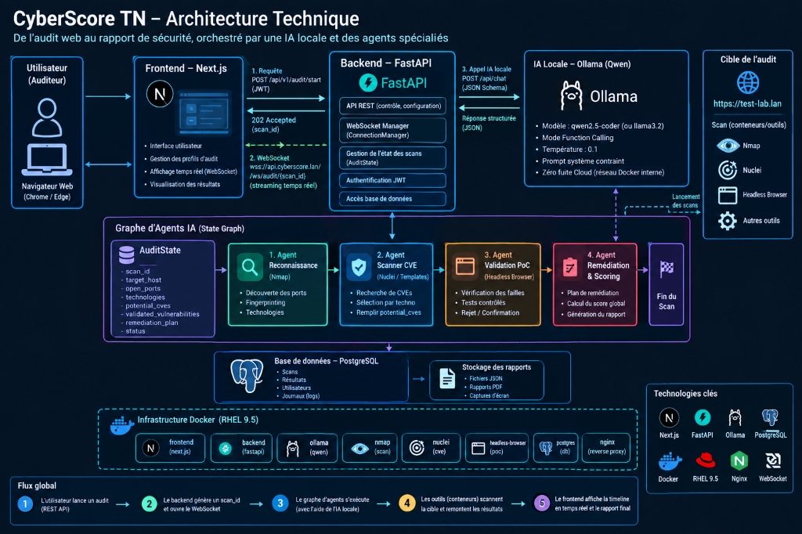

# 🛡️ DOSSIER DE VALIDATION TECHNIQUE — SÉANCE 1
## TEK-UP — Classe : CII-5-J-SSIRF-D (2026-2027)
### Projet : CyberScore TN — Plateforme Souveraine d'Orchestration d'Audit de Sécurité & Pentesting Autonome
**Candidat :** Hamdouni Yosri

---

## 📋 Informations Générales

* **Établissement :** TEK-UP — École Supérieure Privée de Technologie et d'Ingénierie
* **Filière :** Cycle Ingénieur Informatique — Sécurité des Systèmes d'Information et Réseaux (SSIRF)
* **Objet de la Séance 1 :** **Validation de l'architecture, de la démarche d'ingénierie et préparation de la communication**
* **Dossier HTML interactif & stylisé :** [seance1_dossier_architecture.html](file:///c:/Users/yhamd/OneDrive/Desktop/STAGE_PFA/docs/seance1_dossier_architecture.html)

---

## 1. Schéma d'Architecture Technique Officiel



### 🔄 Les 5 Étapes du Flux Global :
1. **Étape 1 :** L'utilisateur lance un audit via l'API REST (`POST /api/v1/audit/start` avec token JWT).
2. **Étape 2 :** Le backend génère un `scan_id` unique et ouvre la connexion persistante WebSocket (`wss://api.cyberscore.lan/ws/audit/{scan_id}`).
3. **Étape 3 :** Le graphe d'agents s'exécute de façon séquentielle avec l'aide du modèle IA local (Ollama / Qwen).
4. **Étape 4 :** Les outils conteneurisés en sandbox (Nmap, Nuclei, Headless Browser) scannent la cible et remontent les résultats structurés.
5. **Étape 5 :** Le frontend Next.js affiche la timeline d'audit en temps réel et génère le rapport final certifié SHA-256.

---

## 2. Décomposition des Composants de l'Architecture

### 🖥️ Frontend — Next.js 14 (TypeScript / Tailwind CSS)
* Interface utilisateur réactive avec support natif RTL (Arabe) et LTR (Français, Anglais).
* Gestion des profils d'audit prédéfinis (Reconnaissance rapide, Détection de CVE, Audit approfondi).
* Streaming des logs et affichage en temps réel via WebSockets.
* Visualisation des matrices de vulnérabilités, radar de score et téléchargement de rapport PDF.

### ⚙️ Backend — FastAPI (Python 3.11 / AsyncIO)
* Point d'entrée de l'API REST pour la configuration et le contrôle des scans.
* `WebSocket Manager` (`ConnectionManager`) pour diffuser les événements sans polling HTTP.
* Maintien de l'objet d'état partagé `AuditState`.
* Authentification JWT et contrôle des accès par rôles (RBAC).
* Accès à PostgreSQL et stockage persistant des rapports d'audit.

### 🧠 IA Locale — Ollama (Qwen)
* Modèle souverain : `qwen2.5-coder:7b` (ou `llama3.2`) déployé en local sur l'hôte.
* Mode **Function Calling** / Structured Outputs (format JSON Schema strict).
* Température fixée à `0.1` pour éliminer tout risque d'hallucination.
* **Zéro fuite Cloud :** Inférences exécutées exclusivement sur le réseau Docker interne.

### 🧭 Graphe d'Agents IA (State Graph)
Tous les agents collaborent séquentiellement en enrichissant l'objet d'état commun `AuditState` :
```python
AuditState = {
    "scan_id": str,
    "target_host": str,
    "open_ports": list[int],
    "technologies": list[str],
    "potential_cves": list[dict],
    "validated_vulnerabilities": list[dict],
    "remediation_plan": str,
    "status": str
}
```
1. **Agent 1 — Reconnaissance (Nmap) :** Découverte des ports ouverts, fingerprinting des services et identification de la stack technologique.
2. **Agent 2 — Scanner CVE (Nuclei / Templates) :** Recherche ciblée de CVEs selon les technologies détectées, remplissage de `potential_cves`.
3. **Agent 3 — Validation PoC (Headless Browser) :** Vérification dynamique des failles sans attaque destructrice, élimination des faux positifs.
4. **Agent 4 — Remédiation & Scoring :** Calcul du score de risque global (CVSS v3.1), rédaction du plan de remédiation technique et scellement du rapport.

### 🐳 Infrastructure Distribuée Tri-VM & Durcissement (DÉPLOYÉE ET VALIDÉE À 100%)
Conformément aux exigences de **Défense en Profondeur (Defense in Depth)** et d'isolation des privilèges requises par l'ANCS et l'encadrement TEK-UP, l'infrastructure est segmentée en 3 machines virtuelles RHEL autonomes sur VMware Workstation :

| VM | IP Déployée | OS / Environnement | Services & Rôles | Sécurité & Confinement |
| :--- | :--- | :--- | :--- | :--- |
| **VM 1 : `CyberScore-DMZ-Front`** | `192.168.98.150` | RHEL 10.1 Minimal (Headless) | Next.js 16 + React 19, Nginx 1.26 (Reverse Proxy Port 80), `cyberscore-front.service` | SELinux Enforcing, Firewalld HTTP/HTTPS, isolation totale du réseau interne |
| **VM 2 : `CyberScore-Core-Back`** | `192.168.98.149` | RHEL 10.1 Minimal (Headless) | FastAPI Python 3.12 (Port 8000), PostgreSQL 16 (`cyberscore` DB seedée), Valkey 7 (Port 6379), Celery Worker (2 workers) | SELinux Enforcing, pare-feu filtré sur sous-réseau VMware, aucun accès public direct |
| **VM 3 : `CyberScore-Agent-Probe`** | `192.168.98.148` | RHEL 9.5 Minimal (Headless) | Graphe des 4 agents IA autonomes (`probe_agent`), outils réseau conteneurisés | SELinux Enforcing, Firewalld DROP policy par défaut, Bastion jetable isolé |
| **Hôte Central (Windows)** | `192.168.98.1` | Windows 11 (GPU) | Accélérateur IA souveraine Ollama (`qwen2.5-coder:7b`, Port 25000), Navigateur client | Réseau VMnet8 (192.168.98.0/24) reliant de façon étanche les 3 machines virtuelles |

---

## 3. Guide de Réponses aux Questions Techniques (« HOW? »)

### Q1. HOW : Comment le Frontend et le Backend communiquent-ils en direct ?
* **Réponse :** Modèle hybride. REST sécurisé par JWT pour démarrer l'audit (`POST /api/v1/audit/start` $\rightarrow$ code `202 Accepted` avec `scan_id`). Aussitôt, le client ouvre `wss://api.cyberscore.lan/ws/audit/{scan_id}`. Le `ConnectionManager` de FastAPI diffuse les événements JSON dès qu'une découverte a lieu, alimentant la timeline React sans rechargement de page.

### Q2. HOW : Comment le Graphe d'Agents s'exécute-t-il ?
* **Réponse :** C'est une machine à états finis (`StateGraph`). L'Agent 1 démarre avec l'état initial, exécute Nmap et remplit `open_ports` et `technologies`. L'Agent 2 lit ces technologies et lance les vérifications de CVE correspondantes. L'Agent 3 vérifie dynamiquement les failles via le navigateur headless pour rejeter les faux positifs. L'Agent 4 consolide le rapport final.

### Q3. HOW : Comment l'IA locale (Ollama) est-elle contrainte sans fuite cloud ?
* **Réponse :** FastAPI et la sonde d'audit appellent Ollama via l'API locale `http://192.168.56.1:25000/api/generate`. L'inférence est contrainte par un prompt système imposant une sortie conforme à un schéma JSON Pydantic. La température fixée à `0.1` garantit la reproductibilité des diagnostics, et aucune donnée ne transite par Internet.

### Q4. HOW : Pourquoi avoir choisi une architecture distribuée à 3 VMs (Tri-VM) ?
* **Réponse :** Pour appliquer le principe de **Défense en Profondeur** et séparer le *Plan de Contrôle* du *Plan d'Exécution Cyber*. Si le frontend (VM 1) subit une injection ou un exploit web, l'attaquant est confiné dans la DMZ et ne peut accéder ni à la base de données (VM 2) ni aux outils d'attaque (VM 3). De plus, si un serveur étatique audité réagit agressivement (contre-scan ou tar-pit), seule la sonde jetable (VM 3) est affectée, garantissant la haute disponibilité continue de la plateforme.

### Q5. HOW : Comment la VM RHEL 9.5 protège-t-elle l'enclave d'audit (Hardening) ?
* **Réponse :** SELinux actif en mode `Enforcing` applique un confinement mandataire strict : même si un script de sonde était corrompu, le noyau RHEL lui interdit formellement d'accéder au système de fichiers hôte (`/etc`, `/root`, `/proc`). Le pare-feu `Firewalld` applique une politique `DROP` par défaut ne laissant ouverts que le port de dialogue interne avec la VM 2 et le port Host-Only vers l'accélérateur IA.

### Q6. HOW : Comment les rapports sont-ils certifiés avec SHA-256 ?
* **Réponse :** Dès la fin de la génération du PDF vectoriel et du rapport JSON, le flux d'octets brut est passé dans la fonction de hachage `hashlib.sha256()`. Le hash résultant est stocké en base de données et gravé sur la couverture du rapport avec un QR code de vérification infalsifiable.
